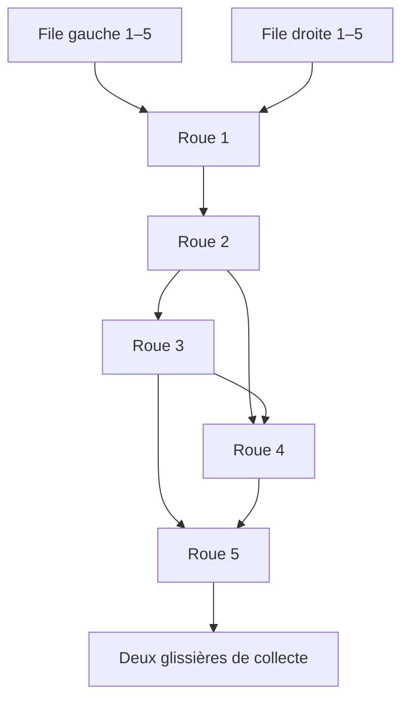

# Cascado — Géométrie de référence V1

Version 1.23 · 30 octobre 2026 · Gabarit courant : **ddc-v1.5** · Profils conservés : **ddc-v1.4** et **ddc-v1.3**

## 1. Décision de conception

Ce document définit la géométrie retenue pour la PWA. Conformément au choix de l’utilisateur, elle combine les proportions de la photo fournie et des caractéristiques du brevet, avec des dimensions et conventions fixées pour le jeu numérique. Elle ne prétend pas reproduire au millimètre une édition MB.

Les paramètres ci-dessous sont des **valeurs de conception**, exprimées en unités de plateau, jamais en millimètres. Le [dossier de recherche](GEOMETRIE-REFERENCES.md) conserve la provenance et les limites des références. Aucune mesure physique supplémentaire n’est nécessaire pour spécifier cette V1.

Ce document est la référence normative du profil courant **`ddc-v1.5`** : deux entrées et deux séries de cinq jetons sur chaque face, avec des décalages estimés d’après la séquence vidéo vers **298–299 s**. Ces estimations autorisées par l’utilisateur ne constituent ni un relevé exact du jeu filmé ni une garantie d’équivalence entre les faces. Les centres, rayons, profils en U, six liaisons et seuil de passage de 20 unités restent conservés.

Les profils **`ddc-v1.4`** et **`ddc-v1.3`** demeurent disponibles pour les parties et séries déjà enregistrées : ils gardent leur entrée unique, leurs cinq jetons par face et leurs décalages. Les versions antérieures migrent uniquement vers `ddc-v1.3`, sans recalage en cours de jeu. La [fiche de recette](RECETTE-V1.md) distingue les preuves historiques des vérifications du nouveau profil.

## 2. Plateau et repère

Le plateau mécanique occupe un rectangle logique de **360 × 540 unités** en `ddc-v1.5` ; les profils sauvegardés `ddc-v1.3` et `ddc-v1.4` conservent **360 × 510 unités**. Son origine est en haut à gauche ; x croît vers la droite, y vers le bas. Un angle de 0° pointe à droite ; les angles positifs sont horaires.

Ce rectangle est la zone du mécanisme, pas l’écran entier. Dans l’interface portrait 9:16, il est réduit uniformément pour laisser la place au bandeau, à l’aide et à la fin de tour, ainsi qu’aux zones réservées au système. La suppression des boutons de rotation et de la molette libère de la hauteur pour le mécanisme ; la manipulation commence sur le disque de la roue et suit ensuite le doigt autour de son centre. La mise à l’échelle conserve les cercles et les rapports entre toutes les dimensions.

### Centres et rayons

La face A suit le côté visible sur la photo fournie. La face B est son opposée. Les identifiants de roue restent identiques lorsqu’on change de face.

| Roue | Centre A : x | Centre A : y | Rayon extérieur | Centre B : x | Centre B : y | Encoches par face |
| --- | --- | --- | --- | --- | --- | --- |
| 1 | 180 | 101 | 47 | 180 | 101 | 1 |
| 2 | 237 | 202 | 57 | 123 | 202 | 3 |
| 3 | 146 | 270 | 46 | 214 | 270 | 2 |
| 4 | 248 | 333 | 64 | 112 | 333 | 4 |
| 5 | 115 | 393 | 72 | 245 | 393 | 5 |

Les centres A reprennent le relevé photographique arrondi, translaté pour réserver les marges du plateau. Les rayons sont légèrement régularisés. Les centres B satisfont xB = 360 − xA et yB = yA. Tous les disques restent séparés et entièrement dans le plateau.

## 3. Jetons et encoches

Chaque joueur dispose de **dix jetons de diamètre 24 unités**, répartis en **deux séries de 1 à 5**. Les identifiants internes 1 à 5 désignent la série gauche et 6 à 10 la série droite ; le numéro imprimé vaut `(id − 1) modulo 5 + 1`. Couleur et symbole distinguent les deux séries sur une même face. Les deux profils sauvegardés 1.3/1.4 conservent cinq jetons par face, identifiés et imprimés de 1 à 5. Le modèle est plan : l’épaisseur, les frottements et les rebonds n’interviennent pas dans les règles de déplacement.

Chaque encoche accueille au plus un jeton. Toutes ont la même forme : une **ouverture en U**, de largeur 28, avec un fond arrondi de rayon 14 et une profondeur totale de 28 depuis le contour extérieur de la roue.

Pour une roue de rayon R et une encoche orientée selon un rayon :

- le centre du fond arrondi se trouve à la distance **R − 14** de l’axe ;
- le fond atteint la distance **R − 28** ;
- les deux flancs parallèles, espacés de 28, rejoignent le bord extérieur et ouvrent réellement l’encoche sur le pourtour ;
- le jeton est représenté au centre du fond, avec un jeu de 2 unités par côté ;
- le profil est découpé dans le disque : une cavité simplement circulaire et tangente au bord ne convient pas.

Les encoches d’une même face sont régulièrement espacées de **360° / n**, où n est leur nombre. Elles ne se recouvrent pas. Le rayon de position du centre d’un jeton porté vaut respectivement **33, 43, 32, 50 et 58 unités** pour les roues 1 à 5.

Le cadre guide les jetons. Une ouverture qui ne débouche pas sur un passage autorisé et ouvert n’éjecte pas son jeton. La V1 ne représente pas de jeton coincé à cheval entre deux roues.

## 4. Calage des deux faces et position neutre

Chaque paire partage un seul angle physique θ. Au départ classique, **θ = 0° pour les cinq paires**. Les séries IA variées utilisent les poses reproductibles décrites plus bas. Les flèches de départ correspondent à la position neutre propre à la version numérique ; elles ne reproduisent pas celles d’un moule commercial.

| Roue | Première encoche A α | Décalage courant δ, `ddc-v1.5` | Écart court signé courant | δ conservé, `ddc-v1.4` | δ conservé, `ddc-v1.3` | Pas s |
| --- | --- | --- | --- | --- | --- | --- |
| 1 | 45° | +75° | +75° | +180° | +90° | 360° |
| 2 | 30° | +90° | −30° | +60° | +36° | 120° |
| 3 | 45° | +90° | +90° | +90° | +45° | 180° |
| 4 | 0° | +20° | +20° | +45° | +45° | 90° |
| 5 | 0° | +15° | +15° | +36° | +36° | 72° |

Les décalages bruts courants sont donc **[75°, 90°, 90°, 20°, 15°]**. Un ensemble d’encoches se répète après s ; son écart court vaut **[75°, −30°, 90°, 20°, 15°]**. La roue 2 présente ainsi une amplitude courte de 30°, avec un signe négatif, même si son paramètre brut vaut +90°. Ces valeurs sont des estimations de conception à partir de la vidéo vers 298–299 s ; elles ne sont pas attribuées à un relevé métrique MB. Les angles α et la position neutre restent des conventions numériques.

Pour l’encoche k, numérotée à partir de 0 :

- **Face A : φA = θ + α + k × 360° / n**.
- **Face B : φB = 180° − (θ + α + δ + k × 360° / n)**.

Les angles sont ramenés modulo 360°. Un geste horaire sur A augmente θ ; un geste horaire sur B diminue θ. Les jetons ne passent jamais d’une face à l’autre. Les ensembles d’angles au neutre, triés uniquement pour la lecture, sont :

| Roue | Angles A, tous profils | Angles B, `ddc-v1.5` | Angles B, `ddc-v1.4` | Angles B, `ddc-v1.3` |
| --- | --- | --- | --- | --- |
| 1 | 45° | 60° | 315° | 45° |
| 2 | 30°, 150°, 270° | 60°, 180°, 300° | 90°, 210°, 330° | 114°, 234°, 354° |
| 3 | 45°, 225° | 45°, 225° | 45°, 225° | 90°, 270° |
| 4 | 0°, 90°, 180°, 270° | 70°, 160°, 250°, 340° | 45°, 135°, 225°, 315° | 45°, 135°, 225°, 315° |
| 5 | 0°, 72°, 144°, 216°, 288° | 21°, 93°, 165°, 237°, 309° | 0°, 72°, 144°, 216°, 288° | 0°, 72°, 144°, 216°, 288° |

Changer d’écran ne réinitialise ni θ ni le calage. Au départ classique, les deux entrées locales sont fermées sur chacune des deux faces ; les deux séries gardent leurs cinq jetons dans leurs files, 1 en tête.

### Portée de l’équivalence historique

Seul **`ddc-v1.4`** retient δ = s / 2 sur chaque roue. Sa transformation T ajoute δ à chaque angle physique et échange A et B ; une ancienne encoche B k devient A k et une ancienne encoche A k devient B **k − 1 modulo n**. Cette propriété est conservée pour rejouer les sauvegardes de ce profil. Elle ne s’applique pas au calage estimé de `ddc-v1.5`, ni aux trois premières roues historiques de `ddc-v1.3`. Aucun résultat ou score n’est corrigé pour compenser une asymétrie.

### Départs variés des séries IA

Le générateur utilise une graine sur 32 bits et le profil sauvegardé. Il rejette uniquement les poses dont une entrée de la première roue est ouverte sur A ou B : les quatre files courantes gardent leurs cinq jetons avant le premier coup. Ce filtrage est géométrique, sans calcul ni sélection de vainqueur.

En **`ddc-v1.5`**, chaque paire rejoue **θ puis θ**, avec le premier joueur inversé. Cent parties forment cinquante paires ; N impair laisse une dernière paire incomplète. Ce protocole ne garantit pas l’équivalence des faces. Les séries sauvegardées **`ddc-v1.4`** conservent **θ puis θ + δ**, et **`ddc-v1.3`** conserve θ puis θ. La graine, les angles initiaux et le profil restent enregistrés ; une reprise ne modifie ni les poses ni le protocole.

## 5. Passages entre roues

La V1 retient exactement les passages descendants suivants :

Le passage **3 → 4 est retenu** comme choix du gabarit numérique. Aucun autre passage n’existe : notamment ni 1 → 3, ni 2 → 5, ni sortie directe de 3 ou 4. Les flèches décrivent les transferts par gravité ; une encoche peut néanmoins porter localement son jeton vers le haut pendant une rotation.

### Construction des portes

Chaque liaison relie les deux centres par une droite. Elle dispose d’un conduit fixe de largeur 28, ouvert entre les deux disques et prolongé jusqu’à leurs ouvertures. Les parties pleines des roues ferment cette liaison tant que les ouvertures des encoches ne se chevauchent pas dans le conduit, selon la section 7.

Des repères fixes matérialisent les portes sur le cadre, indépendamment de l’angle des roues. Les graduations décoratives tous les 15° sont retirées : elles ne correspondaient pas aux angles réels des passages.

La porte de la roue source pointe vers le centre de la roue cible. La porte de réception pointe en sens opposé. Les valeurs arrondies ci-dessous servent à la lecture ; les centres du tableau de la section 2 constituent la référence de calcul.

| Passage | Direction de la porte source A | Direction de réception A | Écart entre contours |
| --- | --- | --- | --- |
| 1 → 2 | 60,56° | 240,56° | 11,97 |
| 2 → 3 | 143,23° | 323,23° | 10,60 |
| 2 → 4 | 85,20° | 265,20° | 10,46 |
| 3 → 4 | 31,70° | 211,70° | 9,89 |
| 3 → 5 | 104,15° | 284,15° | 8,85 |
| 4 → 5 | 155,72° | 335,72° | 9,91 |

Sur B, une direction de porte γ devient **180° − γ**, modulo 360°. Les conduits du cadre sont réfléchis avec les centres ; ils n’acquièrent pas le décalage δ des encoches.

Les écarts, tous inférieurs au diamètre 24 d’un jeton, permettent au cadre et aux disques de retenir le jeton si le récepteur est fermé. La largeur du conduit laisse 2 unités de jeu de chaque côté à l’alignement exact. Le déclenchement assisté décrit en section 7 accepte aussi un chevauchement plus étroit que le diamètre du jeton.

## 6. Glissières d’entrée et réceptacles

### Deux entrées locales du profil courant

Chaque face possède deux files indépendantes, gauche et droite dans la vue de son propriétaire. Elles alimentent la même roue 1 par les portes locales **210°** et **330°**. Ces deux directions restent locales sur A comme sur B ; elles ne sont pas déduites de la réflexion d’une alimentation unique. Chaque file contient sa série 1 à 5 ; seule sa tête peut entrer lorsque le logement récepteur est libre.

Pour l’indice i = 0 à 4, les centres en attente sont :

- gauche : **x = 129 − 24i ; y = 70 − 10,5i** ;
- droite : **x = 231 + 24i ; y = 70 − 10,5i**.

À l’ouverture, le jeton rejoint le siège réel de l’encoche de la roue 1, sans réaligner la roue ; seule la file concernée avance. Le transfert identifie sa provenance par `from: { queue: true, lane: 0 | 1 }`. Les identifiants restent uniques pendant tous les déplacements, même si les deux séries affichent chacune le numéro 1.

### Deux glissières de collecte

La sortie mécanique unique reste en bas de la roue 5, à **90°**. La présentation dirige chaque série vers sa propre rangée inclinée, avec **1 au point bas à gauche et 5 au point haut à droite**, sur les deux faces. L’ordre est vérifié séparément dans chaque série ; la victoire exige les dix sorties correctes. Une erreur dans l’une des séries fixe une défaite, selon l’arbitrage commun.

Pour l’ID t = 1 à 10, poser **c = partie entière de (t − 1) / 5** et **j = (t − 1) modulo 5**. `trayPosition(face, t − 1, version)` donne **x = centreX(roue 5) − 87 + 26j** et **y = 496 + 26c − 3,5j**.

| Numéro imprimé | x sur A | x sur B | y, série gauche | y, série droite |
| --- | --- | --- | --- | --- |
| 1 | 28 | 158 | 496 | 522 |
| 2 | 54 | 184 | 492,5 | 518,5 |
| 3 | 80 | 210 | 489 | 515 |
| 4 | 106 | 236 | 485,5 | 511,5 |
| 5 | 132 | 262 | 482 | 508 |

L’entrée haute de chaque rangée est 4 unités à droite de sa place 5, dans le prolongement de la pente : **x = 136 sur A, 266 sur B**, et **y = 481,461538… + 26c**. Une sortie passe par le guide **(centreX(roue 5), 477)**, puis par cette entrée avant de glisser vers sa place. Tous les segments sont descendants ; la pente finale vaut **−3,5 / 26**. Les dix places sont distinctes et contenues dans le plateau de 540 unités.

Les couleurs et les petits motifs rond/losange distinguent les séries jusque dans les roues et la collecte. Le nom et le symbole du joueur continuent d’identifier la face ; les deux couleurs affichées n’exposent jamais des jetons adverses.

### Profils sauvegardés à cinq jetons

`ddc-v1.3` et `ddc-v1.4` conservent une seule file locale à gauche : tête **(180, 40)**, quatre centres successifs vers (44, 18) avec un pas de 28, entrée supérieure **270°**. Le réceptacle unique garde **x = centreX(roue 5) − 87 + 26i ; y = 494 − 3,5i**, pour i = 0 à 4, avec son entrée haute **(136 ou 266 ; 479,461538…)** et le guide y = 477. Leurs places suivent l’ordre d’arrivée historique et leur règle de victoire à cinq jetons ; aucune seconde série n’est ajoutée au chargement.

Les glissières sont une présentation du cadre fixe, sans porte mécanique supplémentaire à la sortie. Les jetons collectés ne réintègrent pas une roue. Leur affichage ne modifie ni l’événement de sortie ni un verdict acquis.

## 7. Conditions d’un transfert

Un jeton ne change de logement que si toutes les conditions suivantes sont réunies au même instant :

1. Le passage appartient au graphe de la section 5, ou à l’entrée/sortie définie en section 6.
2. L’encoche source contient le jeton et présente son ouverture du côté de sa porte.
3. L’encoche de réception est vide et présente son ouverture du côté de sa porte ; cette condition ne s’applique pas au réceptacle final.
4. Les ouvertures partagent au moins 20 unités de largeur libre dans le conduit de 28, selon le calcul ci-dessous.
5. Le transfert suit le sens descendant de la liaison. La comparaison des hauteurs instantanées des deux sièges n’ajoute aucune condition de passage.

Pour une entrée, la tête de la file concernée remplace le contenu d’une encoche source. Aucune des deux files ne prélève son deuxième jeton avant son premier ; une entrée ne consomme pas la tête de l’autre file.

### Chevauchement des ouvertures

Le passage s’ouvre **lorsque les deux bouches d’encoche présentent une largeur commune libre d’au moins 20 unités dans le conduit de largeur 28**, sur A comme sur B. Ce seuil représente environ **71 %** de la largeur du conduit. L’égalité est acceptée à **10⁻⁷ unité** près ; un simple contact ou un chevauchement plus étroit est refusé. Il n’y a pas de fenêtre angulaire indépendante de ±6°. Le glisser circulaire conserve une légère aimantation des alignements ; les crans clavier de 6° au maximum restent disponibles.

Le profil visible ne change pas. Pour une roue de rayon extérieur R, la demi-largeur angulaire de sa bouche vaut **h = arcsin(14 / R)**. Si l’orientation de l’encoche s’écarte de sa porte de Δ (distinct du décalage δ de calage des faces), ses deux extrémités sur le contour sont aux angles **Δ − h** et **Δ + h** par rapport à cette porte. Sa projection sur la tangente commune au conduit est l’intervalle délimité par **R × sin(Δ − h)** et **R × sin(Δ + h)**, ordonné de la plus petite à la plus grande valeur.

Le moteur ramène les deux bouches dans le même repère transversal. La porte cible faisant face à la source, la projection cible est réfléchie : ses deux bornes locales changent de signe avant d’être remises en ordre. Chaque intervalle est coupé par le corridor fixe **[−14, 14]**. Le transfert devient possible si la largeur de l’intersection des deux intervalles coupés vaut au moins 20 unités, à la tolérance numérique près. `mouthInterval` conserve la projection pure du profil, `passableMouthInterval` refuse une bouche offrant moins de 20 unités dans le corridor et `openingOverlap` vérifie la largeur commune de la paire. Une encoche tournée vers le dos de sa porte est exclue : la projection d’une ouverture située à l’arrière du disque ne peut pas créer un passage.

L’entrée de la file et la sortie vers le réceptacle utilisent chacune une bouche fixe **[−14, 14]** face à la bouche de la roue. Le même seuil de 20 unités s’applique. Il resserre naturellement leur plage de passage, sans fenêtre angulaire ajoutée.

Pour une bouche opposée fixe et projetée **[l, u]**, déjà coupée au corridor et large d’au moins 20, les limites analytiques de l’orientation de la bouche mobile sont **Δmin = arcsin((l + 20) / R) − h** et **Δmax = arcsin((u − 20) / R) + h**, avec les angles exprimés dans la même unité. `openingAngleBounds` fournit ces bornes ; le moteur les utilise pour examiner les seuils rencontrés entre deux commandes. La réflexion de la cible et le sens apparent sur B restent ceux définis ci-dessus.

Cette assistance explicite refuse les petits chevauchements tout en facilitant le geste. **Elle exige 20 unités libres, et non les 24 unités du diamètre complet du jeton** : elle ne revendique donc pas une simulation de collisions rigides. Le jeton rejoint immédiatement son siège d’arrivée lorsque ce seuil est atteint. Les dimensions des jetons, sièges et profils sont conservées ; le moteur ne réaligne jamais les roues pour produire le transfert.

Une réception occupée bloque toujours le passage ; aucun jeton n’est déplacé pour faire de la place. Les marqueurs de passage et l’aide utilisent les mêmes fonctions de `src/openings.js` que le moteur, en comparant les deux ouvertures de chaque paire. Ils reçoivent uniquement la projection de la face affichée.

## 8. Modèle de mouvement et confidentialité

La V1 adopte une **cinématique à gravité idéalisée**. Un jeton porté suit le centre du fond de son encoche. Lorsqu’une liaison devient valide, son transfert logique est immédiat et atomique. La durée réelle d’une chute, les positions intermédiaires instables, les blocages par frottement et les collisions élastiques ne sont pas simulés.

Le passage est considéré franchi dans une configuration ouverte. Le jeton occupe ensuite le logement destinataire, qui le porte avec sa roue. Les effets visuels ne créent pas un deuxième état de jeu. Ils ne doivent ni montrer un jeton traversant une paroi fermée, ni retarder ou suspendre les commandes. La roue présente directement l’angle assisté pendant le glisser, sans retard d’interpolation. La présentation interpole uniquement les crans clavier sur 100 ms et une chute simple entre roues sur 280 ms ; une cascade peut prolonger le trajet visible. Une sortie dure 420 ms et suit la descente puis le glissement décrits en section 6. Les mouvements suivants conservent la continuité des positions et la chute déjà en cours. Avec la préférence de réduction des animations, l’état final s’affiche directement.

**Une chute cachée ne provoque jamais de pause, de ralentissement, de refus de mouvement ou de changement de sensibilité.** Cette exigence exclut les blocages physiques qui permettraient au joueur actif de détecter les jetons adverses.

Le moteur examine toujours une trajectoire angulaire continue. Au toucher, le contact commence sur une roue autorisée et la sélectionne ; le même geste maintenu la tourne en décrivant un arc autour de son centre affiché. Le sens apparent suit le doigt, avec une amplitude **à 1:1 hors des zones d’aimantation**, sur A comme sur B ; le signe de l’angle physique est donc inversé sur B. Un maintien immobile et les appuis hors roue ne produisent aucune rotation.

`src/magnet.js` applique une légère attraction continue autour des mêmes alignements fixes que `mechanicalDetents` : union de toutes les portes et encoches des deux faces. Chaque zone possède un rayon maximal de **3°**, réduit au plus à la moitié des écarts aux aimants voisins. La transformation est **C1**, avec une correction inférieure à **1°** et un plateau d’alignement exact de demi-largeur au plus **0,5°**, limité aussi à **un sixième du rayon de la zone**. Le doigt peut traverser chaque aimant ; aucun verrou ni saut n’est créé. L’angle brut cumulé reste indépendant de l’angle appliqué, afin que la correction ne s’accumule pas au fil des événements. Un nouvel appui immobile ne recale pas une roue déjà assistée.

Les aimants dépendent uniquement de la géométrie fixe des deux faces, jamais des jetons, des réceptions occupées, du joueur actif ou du verdict. Le ressenti est donc identique pour tous les états cachés. Un aimant peut correspondre à un alignement de la face opposée ; il n’annonce ni jeton ni chute.

Depuis la version **1.32**, le clic, le halo vert de **300 ms** et la vibration facultative de **12 ms** signalent uniquement l’entrée dans une ouverture commune d’au moins **20 unités sur 28** entre deux roues de la face affichée. Le seuil est celui du moteur, calculé par projection des deux bouches dans le même corridor. Les fenêtres angulaires dépendent de la position actuelle de la roue voisine ; une seule encoche sur une porte fixe, les entrées et la sortie restent silencieuses. La trajectoire locale réellement appliquée est examinée analytiquement, y compris entre deux événements du pointeur. Un passage déjà ouvert au contact ne signale rien ; une hystérésis de **0,2°** après fermeture évite les répétitions par tremblement, avec au moins **140 ms** entre retours. Le détecteur ne lit que les angles autorisés, jamais les jetons, l’occupation ni le verdict ; une réception occupée ne change donc pas ce signal géométrique. Le halo reste disponible sans vibration. Appui immobile, relâchement et crans clavier ne signalent rien ; masque, perte de focus et interruption annulent le retour sans rejeu. Les aimants physiques restent indépendants de ce détecteur et continuent d’utiliser les arrêts fixes des deux faces.

Une zone centrale de **rayon 12 pixels CSS** suspend la mesure angulaire. En sortir établit une référence, sans saut ; un seuil initial de **2°** filtre les tremblements avant le premier mouvement, puis le suivi est continu avant application de l’aimantation. La capture du pointeur sur un élément stable permet de sortir du disque sans perdre le geste. Le relâchement, l’annulation, la perte de capture, un deuxième contact ou le masque arrêtent immédiatement le suivi, sans inertie ni recalage final. Après l’engagement, toucher une autre roue ne commande aucune rotation. Avant tout mouvement, un nouveau contact sur une roue autorisée peut changer la sélection.

L’alternative clavier conserve des pas de **6° au maximum** à partir de la position actuelle, raccourcis au premier alignement exact rencontré dans le sens demandé. Ces arrêts sont l’union des angles où une encoche de cette roue ouvre exactement une porte d’entrée, de sortie ou de liaison, sur A ou B, pour toutes ses encoches. Ils dépendent uniquement de la géométrie, jamais des jetons, du joueur actif ou d’un verdict ; un arrêt peut donc correspondre à la face opposée sans révéler son état. `src/detents.js` centralise ce calcul par `mechanicalDetents` et `rotationDetentDelta`. Entrée ou Espace sélectionne la roue ; les flèches gauche/droite transmettent les crans, avec répétition après **250 ms**, puis toutes les **100 ms** environ. Aucun cran supplémentaire n’est ajouté au relâchement. Le maintien clavier vise au maximum **60° par seconde**, sans rattrapage après un retard d’affichage ni inertie.

Le nombre de tours et les inversions restent libres. Qu’il provienne du doigt ou du clavier, un mouvement ne saute jamais l’examen des chevauchements intermédiaires. Aucune partie nouvelle ou sauvegardée n’est réalignée spontanément sur une grille. Les nouvelles parties classiques utilisent les angles neutres définis en section 4 et les séries variées leurs poses initiales enregistrées ; les sauvegardes gardent leurs angles exacts. L’aimantation ne modifie pas les profils ni les conditions de réception. Le seuil de passage de 20 unités, introduit avec **ddc-v1.3**, reste inchangé en **ddc-v1.4** et **ddc-v1.5**.

L’arrivée doit toujours présenter une encoche libre dont l’ouverture partage au moins 20 unités avec celle de la source dans le conduit. Atteindre un arrêt exact sur la roue source ne garantit donc pas une chute si la réception est fermée ou occupée. Une indication permanente rappelle cette condition. Il peut être nécessaire de préparer la roue réceptrice lors d’un tour antérieur ; l’engagement d’une seule roue par tour et l’interdiction de la roue adverse précédente restent inchangés.

Les animations ne reçoivent que les transferts de la face affichée. Le bouton haut-parleur active ou coupe les sons. Les roues sont audibles pendant les tours humains et IA, avec un frottement discret espacé de 150 ms. Le clic net concerne uniquement le chevauchement praticable de deux ouvertures de la face affichée pendant le tour humain ; les aimants physiques continuent d’utiliser les deux faces. Les nouvelles chutes adverses, internes comme finales, émettent un son générique demandé explicitement, sans afficher de trajectoire adverse et sans ralentir les IA. Full et la simulation sans plateau restent silencieux. Les trois enregistrements Kenney CC0 et leurs licences restent locaux ; voir [SONS-LIBRES.md](SONS-LIBRES.md). Le passage sous masque annule les interpolations, les impacts sonores encore attendus et toute voix audio en cours. La reprise affiche l’état présent sans rejouer le tour adverse.

Les débuts et fins des plages où les ouvertures partagent au moins 20 unités sont calculés analytiquement sur la trajectoire angulaire parcourue, à partir des bornes projetées et du corridor. Le moteur examine ces événements intermédiaires plutôt que d’échantillonner des images ou de vérifier seulement l’angle final. Le résultat ne dépend pas de la cadence d’affichage. La tolérance de comparaison numérique retenue est **10⁻⁶ degré** pour les événements angulaires et **10⁻⁷ unité** pour le seuil de largeur commune ; elle sert uniquement à comparer les limites, sans réintroduire une fenêtre de jeu de ±6°.

Les événements des deux faces au même instant mécanique sont traités ensemble selon les règles de simultanéité des spécifications. Le premier instant décisif fixe le résultat ; son annonce reste différée jusqu’à la frontière normale de tour, suivie de la révélation sous masque entre humains. Les mouvements ultérieurs ne modifient pas ce verdict.

Un transfert retire et occupe les logements source et cible dans une seule opération. À angle inchangé, les conséquences sont stabilisées jusqu’à ce qu’aucun nouveau transfert ne soit possible ; les événements simultanés sont arbitrés en lot, sans priorité liée au numéro du joueur. Le graphe dirigé des passages est acyclique et descend entre les axes des roues : il garantit la terminaison des cascades. Aucun filtre supplémentaire sur la hauteur instantanée des sièges n’est appliqué.

## 9. Cohérence vérifiée et recette ultérieure

Les vérifications arithmétiques du gabarit donnent :

- aucun chevauchement entre les cinq disques ;
- six liaisons dont le centre cible est plus bas que le centre source ;
- écarts entre disques compris entre 8,85 et 11,97, inférieurs au diamètre du jeton ;
- ouvertures de largeur 28 supérieures au diamètre 24 ;
- encoches d’une même roue sans recouvrement ;
- entrées fermées dans la configuration neutre des deux faces ;
- plateau courant et dix places de réception contenus dans 360 × 540 ; profils historiques contenus dans 360 × 510.

Ces contrôles de conception ne suffisent pas à valider le moteur. La recette de chaque profil doit vérifier chaque transfert sur A et B, le seuil de 20 unités à l’égalité et de chaque côté, le refus du simple contact, des ouvertures arrière et des réceptions occupées, les tours complets, les inversions, la continuité de l’aimantation, l’absence de dérive de l’angle brut, l’ordre d’arrivée et l’absence de fuite au passage. Pour `ddc-v1.4`, elle doit aussi comparer des états et trajectoires transformés par T : ouvertures, transferts, ordre des jetons et verdicts doivent correspondre après échange des faces. Pour `ddc-v1.5`, elle doit également couvrir les deux entrées de chaque face, la conservation de dix IDs uniques, les deux ordres indépendants, les deux couleurs et les deux rangées. Les recettes historiques ne valident pas à elles seules le nouveau profil, dont l’équivalence n’est pas affirmée.

Le gabarit **ddc-v1.3** a introduit le seuil de 20 unités le 29 octobre 2026. **ddc-v1.4** a ajouté les décalages d’un demi-pas ; **ddc-v1.5** ajoute les estimations vidéo, deux entrées et deux séries par face pour les nouvelles parties. Les parties et séries sauvegardées en 1.3 ou 1.4 gardent ce profil jusqu’à leur fin. Les versions `ddc-v1` à `ddc-v1.2` migrent uniquement vers **ddc-v1.3**, sous masque, sans changer angles, jetons, tour, journal ni verdict. Le chargement ne rejoue aucun mouvement, ne stabilise pas de chute et ne réévalue aucun résultat. Aucune sauvegarde existante ne reçoit spontanément le calage, les entrées ou les dix jetons de 1.5.
