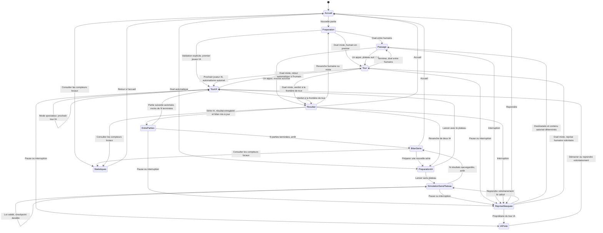

# Cascado — Spécifications de la PWA

Version 1.28 · 31 octobre 2026 · Langue du produit : français

Statut : V1 développée à la demande de l’utilisateur le 28 octobre 2026. La version 1.23 retient **ddc-v1.5** pour les nouvelles parties : décalages estimés de la vidéo vers 298–299 s, deux entrées et deux séries de 1 à 5 sur chaque face. Ce gabarit ne prétend ni reproduire exactement le jeu filmé ni garantir l’équivalence des faces. Le seuil de passage reste de 20 unités libres sur 28. Les parties et séries déjà enregistrées en **ddc-v1.4** ou **ddc-v1.3** gardent leur calage, leur entrée unique et leurs cinq jetons. La version **1.28** rétablit les sons, ajoute un clic de cran à l’aimantation, renforce celle-ci et élargit la saisie autour des roues sans changer les règles de passage. Le glisser circulaire et l’alternative clavier sont conservés. Les preuves exécutées et essais restant à effectuer sont consignés dans la [fiche de recette](RECETTE-V1.md).

## 1. Intention et périmètre

Créer une adaptation du Dix de chute classique pour **deux joueurs locaux sur un seul smartphone**. Chaque place peut être confiée à un humain ou à une IA : humain contre humain, humain contre IA et IA contre IA sont proposés. Entre humains, le téléphone passe après chaque tour et chacun découvre uniquement sa face du mécanisme. Les roues sont communes : les manipuler peut déplacer les jetons des deux joueurs.

L’application est une **PWA installable**, utilisable également dans le navigateur et jouable hors ligne après préparation du cache. L’expérience est conçue en priorité pour le **portrait 9:16**, avec adaptation aux téléphones plus allongés.

| Décision | Première version |
| --- | --- |
| Règles de référence | Principe du Dix de chute ; adaptation numérique 1.23 à deux séries par face |
| Participants | Exactement 2 places locales, chacune humaine ou IA |
| IA | Facile, Normal ou Difficile pour chaque IA ; calcul local, hors ligne et sans accès à la face adverse |
| Vitesse des IA | Avec plateau : Lent, Normal, Rapide ou Full ; réglage global modifiable pendant la partie, indépendant du niveau ; sans plateau : calcul sans attente de présentation |
| Jetons | 10 par joueur : deux séries de 1 à 5, distinguées par couleur et symbole ; IDs internes uniques 1 à 10 |
| Mécanisme | 5 roues et deux faces couplées ; profil courant ddc-v1.5 avec deux entrées par face ; profils ddc-v1.4 et ddc-v1.3 conservés pour les sauvegardes |
| Partie | Un duel, sans chronomètre |
| Passage du téléphone | Entre humains : écran neutre et un seul bouton de révélation ; aucun passage entre les tours humain–IA |
| Duel humain–IA | Face humaine toujours affichée, roues communes animées pendant l’IA, commandes de roue indisponibles pendant son tour |
| Résultat final | Annoncé à une frontière normale de tour ; entre humains, même parcours masqué que pour un tour ordinaire |
| Deux IA | Accès « Duel automatique », série de 1 à 1 000 confrontations et bilan propre à la série ; départs classiques ou variés par paires ; choix entre plateau spectateur et simulation sans plateau, suspendables |
| Simulation sans interface | Commande locale sans navigateur, mêmes moteur et IA, bilan texte ou JSON et graine reproductible pour Facile |
| Connexion | Nécessaire au premier chargement complet ; ensuite jeu hors ligne |
| Conservation | Une partie en cours et son éventuelle série IA, enregistrées localement |
| Statistiques | Compteurs locaux des résultats révélés et profils de joueurs ; remise à zéro confirmée, sans effacer la partie |
| Comptes et serveur de partie | Aucun |
| Présentation | Plateau 2D lisible, commandes tactiles, interface française |
| Son | Activé par défaut avec choix mémorisé ; bouton haut-parleur, clic de cran et sons des jetons visibles ; Full et sans plateau silencieux |

Les croisements avec d’autres jeux, les pouvoirs, le jeu en ligne, les équipes, les classements en ligne et les autres variantes restent hors de cette première version. L’IA locale et le passage à un bouton sont ajoutés à la demande du 29 octobre 2026 ; les statistiques locales, l’accès dédié au duel automatique, les séries de confrontations et le calcul sans plateau suivent le 30 octobre 2026. Le nom retenu pour l’application est **Cascado**, validé le 29 octobre 2026. Le changement de nom conserve le lien publié et les parties sauvegardées, ainsi que les identifiants techniques de stockage et de géométrie ; les mentions de Dix de chute désignent le jeu original et ses sources.

## 2. Règles retenues pour l’adaptation courante

La [notice française MB/Hasbro de 1994](https://ludosierre.ch/zwook/liens/catalogue/0268/texte_fck/image/dixdechute_0001.pdf), dont une copie locale est conservée (archive locale non incluse : `output/pdf/Dix-de-chute-notice-MB-francaise.pdf`), reste une référence historique. Le profil 1.23 explicite le choix demandé de deux entrées et deux séries par face ; il ne prétend pas que toutes ses conventions proviennent de cette notice.

- Au départ classique, les roues sont au neutre. Chaque joueur dispose d’une série 1 à 5 à gauche et d’une autre série 1 à 5 à droite, soit dix jetons sur sa face. Les deux entrées sont fermées avant le premier mouvement.
- Les joueurs alternent. À son tour, un joueur tourne une seule roue, dans le sens choisi, autant qu’il le souhaite ; il peut s’arrêter et reprendre à n’importe quelle position.
- La rotation agit sur les deux faces. Les jetons descendent lorsque les passages vers des logements libres offrent la largeur requise.
- La roue utilisée au tour précédent par l’adversaire est interdite. Exception : le dernier jeton encore en jeu du joueur actif est dans la roue 5, en comptant ensemble ses deux séries.
- Chaque série doit sortir dans l’ordre **1, 2, 3, 4, 5**, indépendamment de l’autre couleur. Les sorties peuvent s’entrelacer : gauche 1, droite 1, droite 2, gauche 2 est valide.
- La victoire exige les **dix sorties correctes**. Sortir un jeton hors de l’ordre de sa série fait perdre son propriétaire, quelle que soit la personne ayant tourné la roue.

Les identifiants internes 1 à 10 assurent l’unicité ; les numéros affichés restent 1 à 5 pour chacune des deux séries. Les profils sauvegardés `ddc-v1.3` et `ddc-v1.4` conservent une série de cinq jetons par face et leur victoire historique à cinq sorties.

### Adaptations numériques explicites

| Sujet | Décision retenue pour la V1 |
| --- | --- |
| Roue interdite | Le logiciel empêche sa rotation et explique pourquoi. La pénalité papier de perte du prochain tour devient inutile, puisque ce geste ne peut pas être effectué. |
| Engagement de la roue | Une sélection seule n’engage pas le tour. Le premier mouvement effectif engage cette roue jusqu’à la fin du tour. |
| Reprise du geste | Lever puis reposer le doigt permet de continuer sur la même roue. |
| Inversion du sens | Autorisée sur la même roue ; elle poursuit la simulation sans restaurer l’état précédent. Les sorties déjà enregistrées restent acquises. La notice n’interdit pas cette manipulation. |
| Passer volontairement | Aucun bouton pour passer : il faut avoir réellement tourné une roue pour terminer son tour. |
| Annonce de fin | Différée jusqu’à la frontière normale de tour ; entre humains, attend ensuite la révélation volontaire du destinataire. Le premier événement décisif conserve sa priorité. |
| Événements exactement simultanés | Convention décrite en section 6, car la notice ne tranche pas ce cas. |
| Passage assisté | Chute à partir de 20 unités de largeur commune libre dans le conduit de 28, soit environ 71 % ; un simple contact ne suffit plus. Ce seuil reste inférieur au diamètre de 24 du jeton ; réception libre obligatoire. |

## 3. Informations visibles et informations cachées

Entre humains et en mode spectateur à deux IA, l’écran peut présenter le nom et le symbole du joueur actif, sa face du plateau, ses deux séries de jetons, leurs sorties et leur prochain numéro attendu, la roue sélectionnée et la roue interdite. Dans une partie humain contre IA, la face affichée est toujours celle de l’humain, même pendant le tour IA ; le libellé du tour indique séparément qui joue. Les deux prochains numéros attendus et la progression sur dix restent ceux de l’humain. Les anciennes sauvegardes présentent leur unique série et une progression sur cinq.

À la demande du 30 octobre 2026, les résultats déjà collectés de l’autre joueur sont partagés pendant le jeu : un petit réceptacle à environ 48 % d’opacité montre son prénom, son compteur et les numéros sortis de chaque série. Il occupe l’espace libre inférieur, à droite sur la face A et à gauche sur B, sans réduire les roues ni recouvrir la collecte propre. Les profils historiques présentent leur seule série de cinq. Ce résumé est non interactif et disparaît avec le plateau au passage et à toute interruption.

Le résumé reçoit uniquement une copie des IDs déjà présents dans `exited`, le profil, le nom et la couleur. Il n’obtient ni jetons encore en jeu, ni positions en roue ou en file, ni journal, angle adverse ou verdict. Les sorties peuvent naturellement permettre des déductions sur le résultat, mais aucune mention gagnant/perdant ni décision n’est lue dans ce calque. L’annonce de fin reste à la frontière normale du tour. Les orientations communes des roues et la roue utilisée au tour précédent restent des informations normales du jeu.

En humain–IA, l’autre joueur est calculé depuis la face humaine affichée, même pendant le tour IA. Le planificateur reçoit toujours `getView` seul ; le résumé public est une projection distincte réservée au rendu. Le mode spectateur continue d’afficher successivement la face active et les résultats collectés de l’autre IA.

Le principe vaut pour tous les canaux : image, texte, sons, vibrations, libellés d’accessibilité, titre de page, notifications et comportement des commandes. Les sons des roues et des seuls jetons de la face affichée sont rétablis ; les chutes cachées, les sorties adverses publiques estompées et le verdict caché ne produisent aucun son. Les enregistrements Kenney sous CC0 et leurs licences restent locaux selon le [dossier des sons libres](SONS-LIBRES.md). Le bouton haut-parleur mémorise le choix de son. Aucune vibration liée aux chutes ou au verdict n’est prévue. Le retour d’alignement, y compris son clic, reste indépendant des jetons.

## 4. Parcours des joueurs

### 4.1 Accueil et préparation

L’accueil propose « Nouvelle partie », « Duel automatique », « Reprendre » lorsqu’une sauvegarde existe, « Statistiques », « Règles » et une aide à l’installation. Les statistiques s’ouvrent sans révéler le plateau ni reprendre une partie ou une IA.

La préparation demande, pour chacune des deux places, un nom et un type « Humain » ou « IA ». Le choix IA fait apparaître son niveau « Facile », « Normal » ou « Difficile », avec Normal par défaut ; le champ de niveau est masqué et désactivé pour un humain. Les noms proposés sont « Camille » et « Léa », limités à 20 caractères et affichés comme texte simple ; un nom vide est remplacé par « Joueur 1 » ou « Joueur 2 ». Chaque joueur reçoit une couleur et un symbole distincts pour identifier sa face. À l’intérieur du plateau courant, deux couleurs et les motifs rond/losange distinguent ses séries gauche et droite ; ces deux couleurs ne désignent pas deux propriétaires. Le premier joueur est choisi explicitement, sans tirage automatique.

Dès qu’au moins une place est confiée à une IA et que le plateau est affiché, la préparation propose « Vitesse des IA » : Lent, Normal, Rapide ou Full. Cette préférence concerne toutes les IA de la partie et reste indépendante des niveaux propres à chaque joueur. Le choix mémorisé est repris ; à défaut, Normal est sélectionné.

Joueur 1 possède la face A et Joueur 2 la face B. Cette attribution est indépendante du choix du premier joueur et reste conservée lors d’une revanche ; seul le premier joueur alterne. Elle est enregistrée dans la sauvegarde.

Le démarrage initialise les deux faces. Entre humains, il affiche l’écran neutre « Passe le téléphone à [prénom] ». Dans une partie mixte, la validation explicite de la préparation ouvre la face humaine et autorise le premier tour, humain ou IA selon le choix. Si le premier joueur est une IA dans un duel spectateur, cette même validation autorise son premier tour automatique. Un simple rechargement ou retour sur un écran ne lance pas d’IA. Aucun aperçu de plateau n’est affiché dans la préparation.

L’entrée **« Duel automatique »** ouvre une préparation dédiée et compacte. Pour une nouvelle série, les deux places portent les noms fixes **IA 1** et **IA 2**, et IA 1 commence la première partie. Les contrôleurs IA sont imposés ; aucun choix Humain, champ de nom ou sélecteur du premier joueur n’y apparaît. Le formulaire contient un niveau Facile, Normal ou Difficile indépendant pour chaque IA, les choix **« Affichage »** et **« Départs »**, et un **nombre entier de parties entre 1 et 1 000**, proposé à **10** par défaut. Les affichages sont **« Sans plateau — simulation rapide »** et **« Avec le plateau »**. Sans préférence enregistrée, Sans plateau est proposé ; le choix n’est mémorisé qu’au lancement. Avec le plateau, la vitesse globale Lent, Normal, Rapide ou Full est proposée. Sans plateau, le contrôle de vitesse est masqué et aucune attente de présentation n’est appliquée. Les choix rapides **10**, **50** et **100** complètent une saisie personnalisée ; une valeur vide, décimale ou hors limites ne lance pas la série et demande une correction. Une phrase indique quelle IA commence, puis précise l’alternance à chaque partie. La préférence de vitesse conservée sur l’appareil est reprise. Le bouton **« Lancer la série »** constitue l’action volontaire autorisant les N confrontations annoncées. Si une partie est déjà sauvegardée, une mention explique son remplacement et le bouton devient **« Remplacer et lancer »** ; ouvrir ou quitter cette préparation ne remplace aucune partie. « Nouvelle partie » conserve la préparation générale avec le choix libre des noms, des types et du premier joueur ; les parties humaines et mixtes gardent le départ classique, sans choix de départ supplémentaire.

Le choix **Départs** propose **« Variés — comparer les IA »**, par défaut sans préférence, et **« Classiques — même position »**. Une graine sur 32 bits détermine les cinq angles initiaux. Les tirages sont acceptés seulement si les deux entrées de la première roue restent fermées sur A et sur B : les quatre files conservent leurs cinq jetons avant le premier coup. Ce filtrage est exclusivement géométrique. En **`ddc-v1.5`**, chaque paire rejoue **la même pose θ / θ**, avec le premier joueur échangé ; cent parties forment cinquante paires, et N impair laisse la dernière paire incomplète. Ce protocole ne garantit pas l’équivalence des faces. Seules les séries sauvegardées **`ddc-v1.4`** conservent leurs poses complémentaires **θ / (θ + δ)** ; **`ddc-v1.3`** conserve θ / θ. Le mode classique garde le neutre. Faces, niveaux, mode et profil restent fixés pour toute la série. Une nouvelle série variée reçoit sa graine au lancement ; pause et rechargement conservent graine, profil et poses initiales.

Après le lancement, les deux IA alternent automatiquement, sans bouton de fin de tour ni passage du téléphone. Avec le plateau, le mode spectateur montre la face active, ses roues et ses jetons. Sans plateau, aucun plateau, roue, jeton, animation ou son n’est créé : seuls la progression, le bilan courant et la pause sont affichés. La progression **« Partie X / N »** reste visible. Chaque résultat est annoncé à une frontière normale de tour et enregistré avant la partie suivante. Le premier joueur alterne entre IA 1 et IA 2 ; les faces, noms et niveaux restent attribués aux mêmes places. Les N parties sont jouées exactement une fois, puis la série s’arrête et présente son bilan, sans créer une partie N + 1. Le nombre de parties, les niveaux, l’affichage et les départs sont fixés pour la série ; la pause reste disponible. Avec le plateau, la vitesse reste modifiable, et **Full** retire les délais de présentation. Sans plateau, le calcul utilise les ressources locales disponibles, sans réglage de vitesse ni estimation de temps garanti ; il conserve les règles et les niveaux de recherche.

Le bilan propre à la série indique le nombre de parties terminées sur N, les victoires de chaque IA, les égalités, le pourcentage de victoires de chaque IA sur les parties terminées, égalités comprises, et la moyenne des tours transmis. La progression, la pause et le bilan identifient les départs avec **« Départs variés · x / y positions jouées »**, puis **« Code des départs : \<seed> »**, ou **« Départs classiques · même position répétée. »**. Ce code correspond à la graine ; aucun champ ne permet de la modifier dans le formulaire. La commande locale permet de la reproduire avec `--seed`. Les deux IA restent distinguées par leur place même si elles ont le même niveau. La série utilise les mêmes décisions locales et règles mécaniques qu’un duel ordinaire ; il n’y a ni résultat extrapolé ni simulation déportée. Le jeu doit rester ouvert et actif : aucune confrontation ne progresse en arrière-plan ou sous verrouillage. Une pause, une interruption ou un rechargement impose une reprise volontaire, y compris entre deux parties, selon la section 9.

La simulation sans plateau utilise un **worker local**, par petits lots, avec les mêmes décisions et le même moteur que le jeu affiché. Si le navigateur ne permet pas le démarrage du worker, un repli local traite un tour par tâche avant de rendre la main. Le planificateur ne reçoit toujours que sa propre projection. Les lots contiennent au plus huit tours ; le budget de 120 ms est vérifié entre les tours, un calcul de coup pouvant durer davantage. Ils rendent régulièrement la main pour permettre la pause ; aucun quota de cadence ou délai de chute n’est appliqué. Chaque résultat est révélé à la frontière normale du tour, puis sauvegardé avec le bilan et les statistiques avant d’autoriser la partie suivante. Une interruption peut abandonner un lot non enregistré ; la reprise repart du dernier checkpoint durable, sans doubler les résultats. Un worker local n’autorise aucune poursuite en arrière-plan ni aucun calcul sur un serveur.

Les décisions de Normal et Difficile sont déterministes : répéter des départs classiques ne crée pas des essais aléatoires indépendants. La version 1.22 avait introduit les demi-pas de `ddc-v1.4` et leurs poses complémentaires ; cette propriété historique reste conservée pour ses sauvegardes. La version 1.23 retient le profil estimé de la vidéo avec deux séries par face, sans affirmer une équivalence mécanique ou un équilibre universel 50/50. Le tri IA conserve sa tolérance numérique et Difficile ses quatre coups et quatre pistes. Aucun tirage n’est filtré par son résultat et aucun score n’est corrigé. Les bilans décrivent seulement leurs positions, niveaux et profils. Un seul onglet actif est prévu par série : deux simulations concurrentes de la même sauvegarde peuvent diverger malgré le dédoublonnage des statistiques globales.

Une série exploratoire de 100 parties entre deux IA Difficiles avec départs variés sur le profil historique `ddc-v1.3` a donné 27 victoires sur A et 73 sur B. Ce diagnostic confirme que la diversification seule ne suffit pas à supprimer le biais observé ; il ne valide pas le nouveau gabarit et ne prédit pas ses résultats. Les validations historiques de `ddc-v1.4` sont consignées séparément dans la fiche de recette ; elles ne valident pas `ddc-v1.5`.

### 4.2 Révélation au début d’un tour

Cette étape concerne les passages entre humains. Les tours ordinaires d’une partie humain contre IA s’enchaînent sur le plateau humain, sans révélation supplémentaire. Après une pause ou une interruption, tous les modes demandent toutefois une reprise volontaire depuis une surface neutre.

La révélation demande **un seul appui volontaire**, sans maintien prolongé. L’écran opaque affiche « Passe le téléphone à Léa », son symbole et le bouton « Je suis Léa — afficher mon plateau ». Cet appui ouvre directement le contenu autorisé : son plateau ou, après une transmission décisive, le résultat final. Il n’y a plus de second écran de confirmation.

Léa est ici un exemple ; tous les libellés utilisent le nom du destinataire. Avant l’appui, aucun aperçu, score ou indice de résultat n’est présenté.

À l’entrée du masque, les actions attendent **300 ms** et le relâchement de tous les contacts précédents avant d’être armées. Le délai est fixe et indépendant de la partie. Le geste ayant terminé le tour, un événement répété ou une touche maintenue ne peut pas révéler le contenu suivant. Après la révélation, la fin de tour reste désactivée tant qu’aucune roue n’a réellement tourné.

Le parcours est identique au toucher, au clavier et avec les technologies d’assistance. Cette simplification remplace expressément le parcours antérieur en deux appuis.

### 4.3 Tour de jeu

1. Le joueur découvre sa face dans son état actuel, y compris les mouvements provoqués par le tour adverse.
2. Le joueur pose le doigt sur une roue autorisée ou dans sa marge de saisie de 16 pixels CSS, le maintient et le déplace en arc autour de son centre. Ce même geste sélectionne puis tourne la roue ; un appui immobile ne produit aucun mouvement.
3. Il peut s’arrêter, reprendre et inverser le mouvement de cette même roue.
4. Après avoir relâché son geste, il choisit « Terminer et masquer » entre humains ou « Terminer mon tour » face à une IA.
5. L’application stabilise le mécanisme et valide la transmission du tour. Entre humains, elle masque immédiatement le plateau ; dans une partie mixte, elle conserve la même face humaine affichée.
6. Entre humains, le téléphone affiche « Passe le téléphone à [autre prénom] ». Dans une partie mixte, le tour IA commence automatiquement, puis rend la main à l’humain sur ce même plateau, sans écran ni confirmation intermédiaires. Les commandes des roues sont indisponibles pendant le tour IA.

Entre humains, le destinataire découvre directement l’état présent de sa face, sans relecture automatique du tour adverse ni notification indiquant combien de ses jetons sont tombés. Dans une partie mixte, l’humain suit en direct les roues communes et les chutes de sa propre face pendant le tour adverse.

### 4.4 Passage du téléphone

Le passage est réservé au duel entre humains. Il n’intervient pas entre deux tours d’une partie humain contre IA ou d’un duel spectateur.

L’écran de passage est opaque et visuellement neutre. Le plateau précédent est retiré de l’affichage et de l’arbre d’accessibilité avant qu’un autre contenu privé puisse être présenté.

Il ne contient aucun score, verdict, historique, animation mécanique, confetti ou message de type « Partie terminée ». Texte, couleurs, bouton et délai sont identiques qu’il reste un tour à jouer ou qu’un verdict soit déjà acquis.

Le changement de face se fait sous ce masque, sans rotation 3D du plateau ni transition montrant les deux côtés. Aucun retour vers le plateau précédent n’est proposé depuis cet écran.

### 4.5 Fin de partie

Entre humains, après transmission du tour, le destinataire utilise exactement le même bouton que lors d’un tour ordinaire. Si un verdict est enregistré, cet appui révèle le résultat final au lieu d’un nouveau tour. Avant l’appui, l’écran de passage ne donne aucun indice de fin de partie. Les tours IA n’annoncent pas un verdict en cours de rotation : l’annonce attend aussi une frontière normale de tour. Dans une partie mixte, le résultat est présenté automatiquement à cette frontière, que le tour terminé appartienne à l’humain ou à l’IA, sans passage ni coup IA fictif. En mode spectateur, le résultat remplace le prochain tour à sa frontière ordinaire.

L’écran indique le gagnant et la cause : série complète de jetons, jeton hors ordre ou égalité selon la convention numérique. Il peut présenter les jetons des deux joueurs au moment décisif ; aucun historique détaillé n’est prévu. Hors série de confrontations, les actions proposées sont « Revanche », « Statistiques » et « Accueil ». Une revanche conserve les noms, types et niveaux, et échange le premier joueur. Pour deux IA, elle rouvre la préparation dédiée IA seule ; un nouvel appui explicite sur son bouton autorise la nouvelle série. Dans une série en cours, le résultat alimente son bilan puis la partie suivante commence sous l’autorisation donnée au lancement, tant que le jeu reste actif. Après la dernière partie, le bilan final arrête l’enchaînement et un nouveau lancement explicite reste nécessaire. Consulter les statistiques ou rouvrir un bilan ne lance aucune partie. La révélation durable du résultat autorise son ajout unique aux compteurs locaux, selon la section 10.1 ; les statistiques n’annoncent jamais un verdict encore caché.

### 4.6 Joueurs IA

L’IA est un programme local, disponible hors ligne sans compte ni modèle distant. Son planificateur reçoit uniquement la projection de sa propre face : angles communs, jetons et sorties de cette face, roue autorisée et engagement éventuel. Il ne reçoit ni positions adverses, ni verdict caché, ni journal privé. Deux états donnant la même projection doivent produire le même choix à niveau et source aléatoire identiques. Les trois niveaux respectent les mêmes règles et cette même limite d’information.

| Niveau | Recherche sur sa propre face |
| --- | --- |
| Facile | Un coup ; choisit le meilleur dans 70 % des cas et varie sinon parmi trois choix sûrs proches |
| Normal | Anticipation de deux coups ; jusqu’à six candidats initiaux et trois pistes pour la suite |
| Difficile | Anticipation de quatre coups ; jusqu’à huit candidats initiaux et quatre pistes à chaque étape suivante |

Les coups candidats sont évalués avec le moteur mécanique réel sur une simulation de sa face et un adversaire vide. Les prochains numéros attendus des deux séries reçoivent la priorité, puis la préparation des passages. Le planificateur distingue leurs IDs uniques tout en appliquant leur ordre 1 à 5 séparément. Cette anticipation ne prédit donc pas les décisions ou les jetons réels de l’adversaire. La rotation d’un coup reste bornée à un tour complet au maximum. Les niveaux décrivent une profondeur de recherche, sans garantie de victoire ni mesure de rapidité sur téléphone physique.

La version 1.21 a porté Difficile à quatre coups, avec au plus huit candidats initiaux puis quatre pistes. La version 1.22 a stabilisé leur tri face aux arrondis. La version 1.23 conserve ces budgets et adapte l’évaluation à deux séries et deux entrées sur `ddc-v1.5`, tout en conservant le calcul à cinq jetons des sauvegardes. L’IA reçoit toujours exclusivement sa propre projection ; Normal et Difficile restent déterministes.

Chaque tour IA choisit une seule roue autorisée et réalise une rotation bornée, puis termine son tour par la transition normale. Un tour repris conserve sa roue déjà engagée. Le calcul et la présentation doivent rester bornés ; il n’existe ni boucle d’attente infinie d’un alignement ni accès réseau pour décider un coup.

À vitesse **Normal**, le rythme permet de suivre le coup : **900 ms de réflexion**, puis **500 ms de présentation de la roue choisie** avant son premier mouvement. La rotation progresse avec un départ et une arrivée adoucis, à une vitesse de référence de **90° par seconde** et sur **700 ms au minimum**. Le moteur accepte successivement les portions réellement parcourues ; le modèle ne saute donc pas immédiatement à l’angle final derrière une animation. Les tours complets et le sens prévu restent conservés. Chaque image ajoute au plus **40 ms** réelles à la progression : un retard d’affichage ne provoque pas une rotation de rattrapage.

Pendant un tour IA, à vitesse Normal, les chutes de la face affichée durent 1,5 fois leur durée habituelle, soit **420 ms entre roues** et **630 ms pour une sortie simple**. Il s’agit des jetons humains dans une partie mixte et des jetons de l’IA active en mode spectateur. Lorsqu’un transfert visible commence, la roue attend la fin de cette animation avec une marge de **120 ms**, pendant **300 ms au minimum**, puis reprend sa progression sans rattrapage. Après le dernier mouvement, l’IA attend **au moins 1 000 ms**, et davantage si nécessaire pour terminer les déplacements visibles avec une marge de **120 ms**, avant de transmettre son tour. Ce rythme est commun aux trois niveaux ; leurs recherches et leur connaissance du plateau restent inchangées. Aucun délai de présentation ne dépend d’un transfert de la face cachée.

Le contrôle « Vitesse des IA » reste disponible pendant les tours humains et IA d’une partie mixte, le duel avec plateau et sa pause IA. Il est masqué dans la simulation sans plateau et n’agit pas sur son calcul. Il propose les quatre rythmes suivants :

| Vitesse | Rythme par rapport à Normal | Présentation |
| --- | --- | --- |
| Lent | × 0,5 ; délais et durées doublés | Rotation progressive ; chute entre roues 840 ms, sortie simple 1 260 ms |
| Normal | × 1 ; rythme de référence ci-dessus | Rotation progressive ; chutes 420 et 630 ms |
| Rapide | × 2 ; délais et durées divisés par deux | Rotation progressive ; chutes 210 et 315 ms |
| Full | Vitesse maximale permise par le calcul local | Aucun délai de présentation, rotation continue ou attente de chute ; positions finales directement affichées |

Le changement prend effet pendant une réflexion, une présentation, une rotation, une chute ou l’attente avant transmission. Le travail déjà effectué n’est pas recommencé : même décision, même roue engagée, même portion angulaire atteinte et même tour. Le nouveau rythme s’applique au reste du mouvement ou de l’attente. Une chute visible en cours conserve sa position ; sa durée restante est recalculée dans le rapport entre l’ancien et le nouveau rythme, avec une seule arrivée. Revenir à une vitesse progressive après Full ne rembobine aucun mouvement déjà accepté.

Full retire uniquement les délais et animations de présentation. Le reste exact de la trajectoire prévue est toujours résolu par le moteur, avec tous ses passages intermédiaires, son sens et ses tours complets ; il ne devient ni un raccourci angulaire ni un nouveau choix de coup. Une cession au navigateur d’au moins **32 ms entre les tours** conserve l’accès à la pause et aux réglages. Les commandes humaines, les règles, les trois niveaux de recherche, la confidentialité et l’annonce des résultats ne changent à aucune vitesse.

Dans un duel humain contre IA, la projection humaine reste affichée pendant la réflexion, la présentation et la rotation de l’IA. Le titre du tour identifie l’IA active ; sa roue choisie est mise en évidence et tourne depuis le point de vue humain, avec le sens apparent propre à cette face. Les jetons humains et leurs transferts sont animés ; un calque statique montre uniquement les sorties déjà collectées de l’IA. L’IA continue de décider depuis sa propre projection : changer la face affichée ne lui donne aucune information supplémentaire. Les commandes de roue et la fin de tour humaine restent indisponibles pendant son action, tandis que la pause et la vitesse restent accessibles. La main revient automatiquement à l’humain sans masque ni confirmation. Aucune pause, animation ou durée supplémentaire ne dépend des jetons cachés de l’IA ou de leurs chutes ; son verdict intermédiaire n’est pas exposé.

Avec deux IA et le plateau affiché, le spectateur voit uniquement la face active à chaque tour et les tours s’enchaînent après le démarrage explicite. Une commande permet de suspendre ; la reprise exige un nouvel appui. Aucune transmission du téléphone n’est demandée entre les IA. Une perte de focus, un changement d’orientation ou un rechargement suspend l’automatisme sans rattrapage ultérieur. Une interruption annule la trajectoire prévue et conserve uniquement les angles et événements déjà acceptés. À la reprise, l’IA prépare la suite depuis cette position réelle et, si elle a commencé à tourner, sur cette même roue : aucun ancien mouvement n’est rejoué.

### 4.7 Simulation locale sans interface graphique

La commande `npm run simulate` lance une nouvelle série sans ouvrir le navigateur, sans plateau et sans dépendre du DOM, du rendu ou du stockage PWA. Elle réutilise les tours du module pur de simulation, le moteur mécanique réel et les IA locales : le planificateur reçoit exclusivement la projection de sa propre face. Le premier joueur alterne ; IA 1 commence la première partie. Elle ne lit ni ne modifie les parties, préférences et statistiques du navigateur.

```sh
npm run simulate -- --games 100 --ai1 hard --ai2 hard --starts varied --seed 42
npm run simulate -- --games 100 --ai1 hard --ai2 hard --starts classic --seed 42 --json
```

| Option | Contrat |
| --- | --- |
| `--games N` | Entier de 1 à 1 000, 10 par défaut |
| `--ai1`, `--ai2` | `easy`, `normal` ou `hard`, `normal` par défaut pour chaque place |
| `--starts MODE` | `classic` ou `varied` ; `classic` par défaut ; sur le profil courant `ddc-v1.5`, `varied` rejoue θ / θ avec le premier joueur échangé ; les séries sauvegardées `ddc-v1.4` gardent θ / (θ + δ) |
| `--seed ENTIER` | Entier sûr, 1 par défaut, normalisé sur 32 bits non signés ; rend reproductibles les départs variés et les choix variables de Facile à paramètres identiques |
| `--max-turns N` | Entier positif, 10 000 par défaut par partie ; borne de sécurité sans création d’un résultat fictif |
| `--json` | Une ligne JSON contenant le statut, le bilan, les paramètres, les résultats par partie et l’éventuelle partie inachevée |
| `--help` | Aide et valeurs par défaut |

Le résultat distingue `completed` (N parties terminées), `stopped` (interruption volontaire) et `incomplete` (limite de tours ou impossibilité de produire un coup valide). Une partie inachevée est signalée avec son numéro, son premier joueur, ses tours et sa cause ; elle n’est comptée ni comme égalité, ni comme victoire, ni dans la moyenne des parties terminées. Les résultats terminés précisent pour chaque partie le premier joueur, le gagnant, la cause et les tours ; le profil de géométrie, la graine et les paramètres de départ permettent de reproduire la série. Les codes de sortie sont 0 pour une série terminée, 1 pour une simulation inachevée, 130 pour `Ctrl+C` après le tour en cours et 2 pour des arguments invalides. En mode varié courant `ddc-v1.5`, la graine produit 50 paires θ / θ pour 100 parties ; pour un nombre impair, la dernière paire reste incomplète. Elle ne modifie pas les décisions déterministes de Normal et Difficile une fois la position initiale définie. Aucun tirage n’est accepté ou rejeté selon le résultat d’une confrontation.

## 5. Modèle mécanique et géométrie de l’adaptation

Le moteur doit représenter un mécanisme commun, et non deux puzzles indépendants. Chaque roue possède un angle physique unique et deux profils d’encoches fixés sur le même axe. Le sens apparent de rotation s’inverse lorsque l’on regarde l’autre face ; celle-ci possède aussi ses propres décalages d’encoches.

Seule la roue choisie tourne. Les autres roues conservent leur angle ; le déplacement des jetons entre roues ne provoque pas une rotation automatique de tous les axes.

Le moteur traite le mouvement sur toute sa trajectoire, avec les transferts entre encoches et la gravité. Un tour complet peut faire tomber des jetons même si l’angle final égale l’angle initial. Inverser la rotation poursuit la simulation selon la géométrie et la gravité ; cela ne restaure pas automatiquement l’état précédent. Une remontée locale d’un jeton porté par une encoche reste possible si la géométrie la permet.

La V1 utilise une cinématique à gravité idéalisée : les jetons sont portés au fond des encoches et leur transfert logique est immédiat lorsqu’un passage s’ouvre vers un logement libre. Le déclenchement exige au moins 20 unités de largeur commune libre entre les ouvertures en U dans le conduit de 28, sans exiger un passage rigide de la largeur complète du jeton. Elle ne simule ni durée réelle des chutes ni blocage par frottement. Cette simplification conserve les décisions de jeu tout en empêchant une chute cachée de modifier la réponse des commandes.

### Invariants du moteur

- Les deux faces évoluent à chaque rotation, y compris lorsque la face active ne contient plus de jeton dans la roue manipulée.
- Un jeton se trouve à un seul endroit et ne traverse jamais une paroi fermée.
- Les transferts suivent exclusivement les connexions dirigées du gabarit sauvegardé, identiques entre ddc-v1.3, ddc-v1.4 et ddc-v1.5, y compris le passage 3 → 4 retenu pour cette adaptation. Le graphe descendant des axes est acyclique ; aucun filtre sur la hauteur instantanée des sièges ne peut fermer un passage dont les ouvertures partagent la largeur minimale requise.
- L’ordre des événements dépend du mouvement mécanique, jamais de l’ordre de traitement des joueurs.
- La même trajectoire donne les mêmes chutes à 30, 60 ou 120 images par seconde.
- Un geste tactile rapide ne peut pas sauter un passage : tous les événements intermédiaires sont résolus sur sa trajectoire.
- Le mécanisme se stabilise avant le début du tour suivant. Aucun déplacement ne continue pendant le passage du téléphone ou en arrière-plan.

### Géométrie courante : ddc-v1.5 ; profils conservés : ddc-v1.4 et ddc-v1.3

La [fiche de géométrie V1](GEOMETRIE-V1.md) est la référence normative du mécanisme. Elle fixe les deux faces, les encoches, les entrées, la sortie, les angles et le calcul de chevauchement des ouvertures.

| Paramètre | Valeur retenue |
| --- | --- |
| Surface mécanique | 360 × 540 unités pour ddc-v1.5 ; 360 × 510 pour les sauvegardes 1.3/1.4 ; redimensionnement uniforme |
| Encoches des roues 1 à 5 | 1, 3, 2, 4, 5 par face |
| Jetons | Diamètre 24 ; deux séries locales de cinq, dix IDs uniques par face |
| Entrées | Gauche 210° et droite 330° sur chaque face ; entrée unique 270° conservée en 1.3/1.4 |
| Collecte | Deux rangées inclinées 1 à 5, une par série, 1 au point bas ; un seul rail pour les anciens profils |
| Encoches | Ouvertures en U de largeur et profondeur 28, fond de rayon 14 ; profil visible conservé |
| Déclenchement du passage | Intersection des bouches projetées dans [−14, 14] d’une largeur d’au moins 20 unités ; égalité acceptée à 10⁻⁷ unité près ; réception libre et ouvertures du côté de leur porte |
| Calage courant des faces | `ddc-v1.5` : δ bruts +75°, +90°, +90°, +20°, +15° ; écarts courts signés +75°, −30°, +90°, +20°, +15° |
| Calage précédent conservé | `ddc-v1.4` : +180°, +60°, +90°, +45°, +36°, demi-pas sur chaque roue |
| Calage historique conservé | `ddc-v1.3` : +90°, +36°, +45°, +45°, +36° pour les parties et séries déjà commencées sous ce profil |
| Passages descendants | 1 → 2 ; 2 → 3 ou 4 ; 3 → 4 ou 5 ; 4 → 5 ; 5 → réceptacle |
| Vue opposée | Centres réfléchis horizontalement et sens apparent de rotation inversé |
| Rotation tactile | Contact initial sur la roue, puis glisser circulaire ; suivi à 1:1 hors aimants, attraction continue près des alignements fixes, aucun recalage au relâchement |
| Protection du geste | Saisie jusqu’à 16 pixels CSS autour du bord ; zone centrale neutre de rayon 12 pixels CSS ; seuil initial de 2° ; aucun mouvement immobile |
| Clavier | Entrée/Espace pour sélectionner, flèches gauche/droite par pas assistés de 6° au maximum ; maintien après 250 ms puis toutes les 100 ms environ |

Les centres et rayons viennent du gabarit photographique ; le brevet inspire les profils et les décalages historiques. Les décalages courants sont estimés d’après la vidéo vers **298–299 s**, avec l’accord de l’utilisateur. Ce sont des hypothèses numériques, sans reproduction métrique, identification exacte du moule ou garantie d’équivalence entre les faces. Les écarts courts sont calculés modulo le pas des encoches : le paramètre brut +90° de la roue 2 équivaut à un écart signé −30°. Les deux entrées et les dix jetons constituent le choix courant de l’adaptation.

Le profil sauvegardé `ddc-v1.4` conserve sa propriété δ = s / 2. Sa transformation T ajoute δ à chaque angle, échange A et B et renumérote circulairement les encoches de B ; elle préserve les possibilités de passage réfléchies de ce profil. Cette propriété ne s’étend pas au calage courant `ddc-v1.5` ; ses départs appariés θ / θ ne compensent pas un éventuel avantage de face ou de premier joueur. Aucun résultat n’est modifié après calcul.

**La recherche d’une reproduction métrique MB 1994 et le relevé physique ne sont plus des préalables.** Le [dossier documentaire](GEOMETRIE-REFERENCES.md) est conservé comme historique des références, sans imposer une nouvelle photographie ou un relevé de pièces.

Les contrôles arithmétiques confirment que les disques ne se chevauchent pas, que les axes des passages sont descendants et que les ouvertures en U ont une largeur de 28 pour des jetons de diamètre 24. L’assistance commune à ddc-v1.3, ddc-v1.4 et ddc-v1.5 autorise un transfert à partir d’une intersection de 20 unités : elle refuse les contacts et petits chevauchements, tout en restant en dessous d’une largeur libre de 24. La fiche de recette distingue les vérifications du profil courant des essais historiques sur les versions précédentes.

Pour chaque bouche, **h = arcsin(14 / R)** et Δ est l’écart local de l’encoche à sa porte, distinct du décalage de calage des faces. Les extrémités de l’ouverture sur le contour, Δ − h et Δ + h, donnent les bornes projetées **R × sin(Δ − h)** et **R × sin(Δ + h)**. La projection de la cible est réfléchie pour partager la tangente de la source. Chaque intervalle est coupé au corridor **[−14, 14]** ; l’intersection des deux intervalles coupés doit mesurer **au moins 20 unités**. L’égalité est acceptée à **10⁻⁷ unité** près. Une ouverture située au dos de sa porte est exclue. Chacune des entrées et le réceptacle présentent une bouche fixe [−14, 14] et utilisent le même seuil.

Le moteur calcule analytiquement les bornes de chevauchement rencontrées pendant le mouvement, y compris entre deux angles de commande. Les marqueurs et l’aide utilisent les mêmes fonctions de `src/openings.js` pour comparer les ouvertures par paire, uniquement à partir de la projection autorisée. La réponse du glisser, les crans clavier, les sens de rotation et les délais restent indépendants de l’état caché.

## 6. Arbitrage et résultat différé

### Premier événement décisif

Le moteur enregistre chronologiquement toutes les sorties. Le premier instant mécanique comportant une condition de fin fixe le verdict, après évaluation complète de tous les événements simultanés de cet instant. Ce verdict devient immuable.

La confidentialité interdit d’arrêter automatiquement la roue, de terminer le tour ou de modifier les commandes lorsqu’un résultat apparaît sur la face cachée. Le joueur continue donc à manipuler sa roue et termine son tour normalement. La simulation physique continue pour garder un comportement cohérent, mais les événements postérieurs ne changent plus le verdict. Le résultat final utilise l’état enregistré à l’instant décisif.

La même politique s’applique à une fin causée par la face visible. Le joueur peut la déduire de ses propres jetons, mais aucune annonce spéciale ne contourne le passage neutre. Cette différence entre l’instant où la partie est décidée et celui où elle est annoncée est une adaptation au téléphone partagé.

### Événements simultanés : convention retenue

Les événements sont simultanés uniquement s’ils appartiennent au même instant mécanique résolu, pas simplement à la même image d’animation.

- Plusieurs sorties sur une face sont regroupées par série. Chaque groupe doit former exactement ses prochains numéros consécutifs : si le prochain numéro gauche est 2 et le droit 1, gauche 2 et 3 avec droite 1 est valide ; gauche 2 et 4 reste une erreur. Finir une seule série ne donne pas la victoire tant que l’autre n’est pas complète.
- Les conséquences des deux faces à cet instant sont évaluées ensemble.
- Si elles désignent le même gagnant, ce joueur gagne.
- Si elles désignent des gagnants différents, la partie est nulle.

Cette convention, absente de la notice, devra être conservée dans les règles intégrées au produit. Les trois profils fixent une tolérance de comparaison de 10⁻⁶ degré pour les événements angulaires, distincte du critère géométrique de chevauchement des ouvertures. Un changement de fréquence d’affichage ne doit jamais changer le verdict.

## 7. Interface portrait et commandes

Les [maquettes visuelles V1](MAQUETTES-V1.md) présentent le plateau et le passage du téléphone en 9:16. Elles constituent une référence de composition statique historique ; aucun fonctionnement du jeu n’y est implémenté. La présente version remplace leurs anciennes commandes par la manipulation directe des roues et conserve le plateau agrandi.

### Composition de l’écran

| Zone | Contenu |
| --- | --- |
| Bandeau supérieur | Prénom actif, symbole, accès à la pause et bouton haut-parleur |
| Zone principale | Deux glissières d’entrée, cinq roues, deux séries et collecte de la face autorisée : humaine pendant les deux tours d’une partie mixte, active dans les autres modes |
| Réceptacle | Série personnelle sortie et prochain numéro attendu |
| Indications et fin de tour | Roue sélectionnée, aide au glisser circulaire et fin de tour humain ; masque entre humains, continuité du plateau en partie mixte ; aucun bouton de rotation ni molette |

La composition de référence est **360 × 640 pixels CSS**, soit 9:16. Le plateau et l’action principale doivent rester entièrement accessibles sans défilement sur cette taille. Le plateau est bord à bord ; le prénom, la progression, l’aide, la pause et les commandes discrètes occupent les bandes libres en haut et en bas. Les cibles tactiles restent de 44 pixels et les glissières restent dégagées. Le jeu et le passage du téléphone verrouillent le défilement, y compris pendant les tours IA et les transitions. Les écrans de contenu retrouvent leur défilement normal. Les surfaces plus grandes gagnent de l’espace sans étirer la géométrie. Les encoches du téléphone, la barre système et les barres du navigateur sont prises en compte.

Le mode onglet sur iPhone ne nécessite aucune installation. Pendant une surface verrouillée, la hauteur utile est capturée en pixels depuis `100svh` et `innerHeight`, avec une marge technique d’un pixel ; `visualViewport.height` n’impose pas la hauteur transitoire du clavier. La racine, le corps et le cadre sont bornés explicitement. Le plateau est positionné dans ce cadre, indépendamment des variations de `100dvh`. Le verrou conserve sa hauteur pendant les rotations et passages, puis se recale après changement de largeur/orientation ou reprise. Le premier contact sur une roue ou le fond annule le déplacement natif ; les écouteurs conservés sur la cible tactile initiale couvrent le remplacement du SVG. Les boutons, liens, labels et contrôles de saisie gardent leur activation native. Les références tactiles sont libérées à la fin, à l’annulation, au masque de suspension ou au déverrouillage. Les barres natives du navigateur restent sous le contrôle d’iOS ; l’immobilité de ces barres n’est pas une garantie du jeu.

En paysage, une surface neutre demande de remettre le téléphone en portrait ; le jeu est suspendu. Le retour au portrait ne révèle pas automatiquement le plateau. Le fond du plateau couvre tout le viewport, y compris sur ordinateur ou tablette, sans cadre de téléphone. Le mécanisme conserve ses proportions et reste centré dans la zone disponible.

### Rotation tactile

Le contact commence **sur une roue ou jusqu’à 16 pixels CSS autour de son bord**. Le disque réellement touché a priorité sur toute marge voisine. Hors des disques, la roue dont le bord est le plus proche dans cette marge est retenue. Ce choix géométrique inclut les roues interdites : toucher leur disque ou leur marge n’autorise pas à saisir une autre roue en les ignorant. La légalité est vérifiée après la désignation de la roue. Les boutons, liens et contrôles de saisie restent exclus de ce geste.

Si la roue désignée est autorisée, le contact la sélectionne, puis le même contact permet de la tourner en traçant un arc autour de son centre. Un appui bref ou maintenu sans déplacement ne tourne pas la roue et n’engage pas le tour. Avant le premier mouvement effectif, un nouveau contact sur une autre roue autorisée change la sélection. Un contact commencé au-delà de la marge de saisie ne commande aucune rotation. Cette marge est exprimée en pixels CSS et reste constante quelle que soit l’échelle du plateau ; elle ne change ni les disques visibles, ni la géométrie mécanique.

Le déplacement angulaire du doigt est calculé autour du centre réellement affiché de la roue, y compris sur la face B. La roue suit **le même sens, à 1:1 hors des zones d’aimantation**. Les segments successifs franchissent correctement 0°/360° et permettent les tours complets ainsi que les inversions. Le moteur reçoit l’ensemble des angles assistés parcourus, sans saut de simulation. La face opposée conserve le sens physique inverse défini par le gabarit.

L’aimantation renforcée de la version 1.28 attire continûment vers les alignements exacts de l’union des deux faces, calculés par `mechanicalDetents`. Chaque zone a un rayon maximal de **5°**, réduit au plus à la moitié des écarts avec les aimants voisins. La transition est continue avec une dérivée continue (**C1**) ; la correction reste inférieure à **1,5°**. Un petit plateau retient l’alignement exact, de demi-largeur au plus **1°** et au plus **un quart du rayon de la zone**. Ces valeurs remplacent le champ de 3°, le plateau de 0,5° et sa limite au sixième utilisés auparavant. Continuer le geste traverse l’aimant, sans verrou ni saut. Le seuil de passage des jetons reste inchangé à 20 unités libres sur 28.

Le déplacement brut cumulé du doigt reste distinct de l’angle appliqué : l’assistance ne s’additionne pas à elle-même au fil des événements. Un nouvel appui sur une position déjà assistée ne provoque aucun mouvement. L’aimantation est calculée uniquement à partir de la géométrie fixe des deux faces, jamais des jetons, de l’encoche occupée, du joueur actif ou du verdict. Elle garde donc le même ressenti dans tous les états cachés ; elle ne garantit pas une réception ouverte ou libre.

Pendant le glisser tactile, l’arrivée effective sur le petit plateau d’un alignement aimanté déclenche un **clic net de cran** si le son est activé, un **halo vert discret de 300 ms** autour de la roue et, si disponible, une **vibration unique de 12 ms**. Une traversée du plateau entre deux événements du pointeur est également reconnue. Un même alignement ne signale qu’une fois tant que le doigt n’a pas quitté son champ ; un délai minimal commun de **140 ms** entre retours évite leur accumulation. Le clic suit la même décision de signal que le halo et la vibration ; il ne forme pas une seconde file d’événements. Un simple appui, une immobilité ou le relâchement ne déclenchent aucun signal. Le clavier conserve ses crans sans ce retour d’aimantation. Le calcul repose exclusivement sur la trajectoire brute et les alignements fixes des deux faces ; il ne lit jamais les jetons ni le verdict.

La vibration reste facultative : l’absence d’API ou un refus du navigateur ne bloque pas le jeu et ne demande ni autorisation supplémentaire ni nouveau réglage. Le [support de `navigator.vibrate`](https://developer.mozilla.org/en-US/docs/Web/API/Navigator/vibrate) est incomplet ; Safari ne fournit pas cette vibration. Le halo constitue le retour commun. Avec `prefers-reduced-motion`, l’indication visuelle reste brève et sans animation, et la vibration est supprimée. Un masque, une perte de focus ou une interruption annule le retour visuel en cours et la vibration ; aucun signal n’est rejoué à la reprise.

Une zone neutre de **rayon 12 pixels CSS** entoure le centre. Un appui dans cette zone sélectionne la roue mais attend que le doigt s’en éloigne ; le premier point extérieur fixe alors la référence angulaire, sans saut. Revenir dans cette zone suspend la mesure ; en ressortir fixe de nouveau une référence sans mouvement artificiel. Avant la première rotation, un écart angulaire de **2°** filtre les petits tremblements. Une fois ce seuil franchi, le suivi devient continu ; son angle brut conserve l’amplitude du geste depuis sa référence avant application de l’aimantation.

La capture du pointeur reste attachée à un élément stable pendant le renouvellement du SVG : le doigt peut sortir du disque sans interrompre son mouvement autour du même centre. Le relâchement arrête immédiatement le geste, **sans inertie, cran final ni recalage**. Un contact multiple, une annulation de pointeur, une perte de capture, une interruption ou un masque l’arrêtent aussi ; aucune rotation supplémentaire n’est ajoutée. Reposer le doigt sur la même roue permet de poursuivre.

Une fois la roue engagée, un appui sur une autre roue ne la manipule pas et ne tourne pas indirectement la roue engagée. Toucher une roue interdite affiche seulement une explication locale. Les boutons de pause et de fin conservent leur propre action. Le bouton de fin est désactivé tant qu’aucun mouvement effectif n’a eu lieu ou qu’un doigt pilote encore le geste. Pendant un tour IA, les roues affichées sont en lecture seule : aucun pointeur ni raccourci clavier ne peut ajouter de rotation.

Au clavier, **Entrée ou Espace** sélectionne une roue puis place le focus sur le contrôle d’angle accessible. Les flèches gauche/droite transmettent un pas de **6° au maximum**, raccourci au premier alignement exact rencontré. Les arrêts sont calculés pour toutes les encoches et portes de cette roue sur les deux faces, indépendamment des jetons et du verdict. Le maintien clavier commence après **250 ms**, puis répète un cran toutes les **100 ms** environ, sans cran supplémentaire au relâchement. Il n’y a ni rafale de rattrapage après un retard d’affichage ni inertie. Cette alternative ne crée pas de boutons de rotation ni de molette.

Le moteur résout tous les passages intermédiaires, sur les deux faces, quelle que soit la cadence des événements du pointeur ou du clavier. Les angles neutres des nouvelles parties et les angles des sauvegardes restent inchangés. Aucun recalage spontané n’a lieu au chargement. Une chute est déclenchée lorsque la largeur commune atteint 20 unités, indépendamment des aimants et des arrêts exacts disponibles au clavier.

Les portes du cadre reçoivent des repères fixes ; les traits décoratifs tous les 15° sont retirés, car ils ne représentaient pas les passages réels. Une aide permanente rappelle qu’une chute exige aussi une **encoche réceptrice libre et orientée vers le passage**. Un arrêt sur la roue source ne force jamais une réception fermée ou occupée. Le joueur peut préparer la roue réceptrice lors d’un tour antérieur, puis amener le jeton lors d’un tour ultérieur. L’engagement de la roue et l’interdiction de la roue utilisée au tour adverse précédent restent inchangés.

### Animations et sons

Pendant le glisser, la roue présente directement l’angle assisté, sans retard d’interpolation. Les crans clavier sont interpolés sur **100 ms**. Une chute simple entre roues dure **280 ms**, avec prolongement en cas de cascade visible. Une sortie utilise **420 ms** : descente sous la roue 5 au guide y = 477, jonction avec l’entrée haute de la rangée de sa série, puis glissement vers son emplacement, sans segment montant. Les deux glissières de collecte courantes sont numérotées **1 à 5 de gauche à droite**, avec **1 au point bas** sur chaque rangée et chaque face. Une seule rampe demeure pour les sauvegardes 1.3/1.4. Les centres sont définis dans la fiche de géométrie. Les animations sont indexées par ID unique, donc les deux jetons imprimés 1 ne peuvent ni fusionner ni échanger leurs trajectoires. Chaque file avance indépendamment en glissant ; l’affichage ne modifie ni sortie logique ni verdict.

Les jetons disposent d’une identité et d’une couche de rendu distinctes des roues. Les mouvements successifs repartent de la position visuelle courante, sans doubler les jetons ni recommencer une chute en cours. Le moteur reste **immédiat et atomique pour chaque mouvement accepté** : les animations n’ajoutent aucun délai de simulation ni blocage de commande humaine. Les mouvements IA sont eux-mêmes distribués progressivement dans le temps selon la section 4.6 ; leur rendu suit ces angles successifs, sans interpolation qui raccourcirait un tour complet ou inverserait sa direction. Les animations reçoivent uniquement la projection autorisée et ses transferts visibles. Avec `prefers-reduced-motion`, l’interface affiche directement les positions mécaniques successives au lieu d’interpoler les chutes ; le rythme des tours IA reste lisible.

Le son est disponible (`SOUND_AVAILABLE = true`) avec un bouton haut-parleur. La préférence **`ddc-sound-v2`** démarre avec le son activé en l’absence de nouveau choix, puis conserve les activations et mises en sourdine du joueur. Le son attend une interaction permettant au navigateur d’ouvrir son contexte audio ; une absence d’API, un décodage refusé ou un contexte suspendu ne bloque jamais une rotation et n’ajoute aucun son à rejouer plus tard.

Les trois enregistrements locaux de Kenney sous **CC0** couvrent les mouvements de roue, le cran aimanté, le glissement et le contact d’un jeton visible. Mouvement de roue et cran partagent `wheel.wav`, chargé et décodé une seule fois : le mouvement utilise un gain de **0,35**, le cran un gain de **1** et une vitesse de lecture de **0,82**, avant le volume général. Le cran est limité à **un son par 140 ms**, en cohérence avec le retour d’alignement. Les sons de jetons suivent seulement la face affichée, jamais les événements cachés ou le réceptacle adverse estompé. Les modes **Full** et **sans plateau** restent silencieux. Leur provenance et leurs licences sont détaillées dans [SONS-LIBRES.md](SONS-LIBRES.md).

Le masquage, la pause ou une interruption annulent immédiatement les animations, leurs sons d’arrivée différés et les voix audio en cours. Aucune animation ni aucun son du tour précédent n’est rejoué à la révélation suivante. Le destinataire découvre directement son état présent.

### Accessibilité et lisibilité

- Cibles des boutons d’au moins 44 × 44 pixels CSS. Les marges de saisie des roues peuvent se rencontrer ; la priorité au disque puis au bord le plus proche rend le choix déterministe.
- Numéros lisibles, contraste suffisant et distinction des joueurs par symbole en plus de la couleur.
- Les roues restent sélectionnables au clavier. Entrée ou Espace sélectionne la roue puis place le focus sur un contrôle d’angle stable. Il accepte les flèches gauche/droite avec les crans assistés et le maintien clavier, sans ajouter de boutons de rotation visibles ; aucune rotation tactile n’est indispensable.
- Le zoom et le redimensionnement du texte restent utilisables ; les vues non ludiques peuvent défiler.
- La préférence de réduction des animations supprime l’interpolation ; les nouvelles positions mécaniques restent immédiatement lisibles.
- L’arbre d’accessibilité contient la face autorisée et le résumé public des sorties adverses ; aucun verdict caché n’est annoncé dans une région dynamique.

## 8. États et transitions



« Passage » ne divulgue jamais la présence d’un verdict. La reprise restaure d’abord l’état masqué et demande un appui volontaire : elle ne lance ni un nouveau tour ni une annonce de résultat à elle seule. Une IA attend une reprise explicite. Le contenu autorisé dépend de la transmission du tour, selon la section 9 ; la seule présence d’un verdict ne suffit pas à autoriser son annonce. Un résultat déjà révélé peut être rouvert volontairement depuis l’accueil avec le même parcours masqué. Dans un duel mixte, « Tour » et « TourIA » partagent la même projection humaine ; aucun écran de passage ne les sépare. Dans un duel IA contre IA avec plateau, « TourIA » montre la seule face de l’IA active en mode spectateur. « SimulationSansPlateau » n’affiche aucune projection mécanique et utilise le calcul local par lots.

L’enchaînement par « EntreParties » ne concerne que la série explicitement configurée. L’application distingue un résultat déjà ajouté au bilan d’une prochaine partie déjà créée, afin de ne ni doubler le résultat ni sauter une partie au rechargement. Une série ayant atteint N parties ne peut reprendre que son bilan final. Les transitions des parties entre humains et humain contre IA restent inchangées.

## 9. Interruptions et reprise

Une mise en arrière-plan, une perte de focus, un verrouillage, une navigation hors du jeu ou un passage en paysage masque la partie et suspend les commandes. Le mouvement est conservé jusqu’au dernier segment accepté ; aucune entrée supplémentaire n’est générée. La stabilisation et l’enregistrement des conséquences de ce segment appartiennent à sa validation atomique. Ensuite, aucune durée mécanique ne s’écoule pendant la suspension. Le temps réel passé hors de l’application n’est jamais rattrapé au retour. Les interpolations et les voix audio en cours sont annulées dès le masquage ; leur fin visuelle ou sonore n’est jamais reportée sur le passage ni sur la reprise.

Au retour, l’application présente le masque pour le bon propriétaire du tour et demande un seul appui volontaire. Si la transmission avait déjà été validée, ce propriétaire est le destinataire ; sinon, c’est le joueur interrompu. Entre humains, le masque indique « Passe le téléphone à [prénom] ». Une partie mixte propose « Reprendre la partie » sans demander de passer le téléphone ; après cet appui, la face humaine réapparaît, avec ou sans commandes selon le propriétaire du tour. Une IA attend toujours une commande explicite de reprise. Aucune autorisation antérieure ni minuterie automatique n’est restaurée. La sélection et l’engagement de la roue restent conservés. Une pause n’autorise ni un changement de roue ni une annulation de chute.

Si un verdict a été acquis avant l’interruption mais que le joueur n’a pas encore transmis son tour, l’appui de reprise révèle uniquement le plateau autorisé avec ses commandes ordinaires. Il termine le tour et effectue la transmission prévue avant toute annonce : passage masqué entre humains, continuité sur la face humaine en partie mixte. Après une transmission déjà validée, l’appui révèle le résultat si un verdict est acquis, ou le plateau autorisé sinon. Si le résultat avait déjà été révélé avant l’interruption, l’appui rouvre cet écran de résultat, jamais un plateau jouable. La même priorité de parcours vaut pour une IA reprise : elle poursuit son tour ordinaire jusqu’à sa transmission et ne s’arrête pas sur la seule lecture d’un verdict caché.

Un rechargement démarre sur une surface neutre, avant même la lecture de la sauvegarde. Aucun ancien plateau ne doit apparaître une image avant le masque. L’historique du navigateur ne sert pas à consulter des états privés précédents.

Dans une série IA, ces interruptions suspendent aussi l’enchaînement entre deux parties. Le dernier résultat et le bilan durable sont conservés ; aucun délai n’autorise à lancer la partie suivante pendant la pause. Une reprise explicite poursuit la partie déjà créée ou prépare l’unique suivante encore attendue, puis continue jusqu’au total fixé. Le temps passé hors du jeu ne produit aucun résultat supplémentaire. Aucun dispositif n’est ajouté pour poursuivre sous verrouillage ou maintenir l’écran éveillé : l’utilisateur garde le jeu ouvert et actif.

En simulation sans plateau, la pause ou l’interruption arrête le worker ou annule la prochaine tâche du repli local. Le dernier checkpoint durable reste l’autorité ; un lot encore en calcul ou non validé peut être abandonné. Aucun message tardif du worker arrêté ne peut faire progresser la sauvegarde ni lancer une autre partie. Au retour, la série reste en pause jusqu’à une action explicite. Un rechargement ne réinstancie pas le calcul automatiquement. Le checkpoint inclut le modèle et le bilan déjà validés, et chaque résultat terminé est enregistré avant l’enchaînement suivant.

La PWA protège les informations dans son interface et son parcours normal. Elle ne peut pas garantir l’effacement d’une miniature déjà capturée par le système d’exploitation, ni authentifier la personne qui tient le téléphone. La conception n’utilise donc pas le sélecteur d’applications comme mécanisme de passage.

## 10. Sauvegarde et données

La partie est locale au navigateur ou à l’installation utilisée. Une nouvelle partie remplace l’ancienne après confirmation lorsqu’elle existe.

Le modèle conserve au minimum :

| Groupe | Données nécessaires |
| --- | --- |
| Identité | Identifiant local de partie, noms, couleurs, symboles et attribution Joueur 1/A, Joueur 2/B |
| Contrôle | Pour chaque joueur, `controller: 'human' \| 'ai'` et `level: 'easy' \| 'normal' \| 'hard'` |
| Version | Version de sauvegarde, de règles et profil du gabarit mécanique dans `game.geometryVersion` |
| Mécanique | Angles physiques, IDs uniques dans une file plate `queue`, logements et `exited` ; projection dérivée `queues` gauche/droite, `nextBySeries` et total 10 selon le profil, 5 pour les anciens |
| Tour | Joueur actif, numéro du tour, roue engagée et dernière roue adverse |
| Parcours | Tour ouvert, transmission validée, ou résultat déjà révélé |
| Arbitrage | Événements de sortie ordonnés et premier verdict éventuel, avec état décisif |
| Affichage de série | `game.simulationMode = 'headless'` pour une série sans plateau ; absence de cette valeur : plateau conservé |
| Départs de série | `game.startConfig = { mode: 'varied', seed }` pour des départs variés reproductibles ; absence de cette valeur : départ classique ; `startingAngles` conserve les angles initiaux de la partie indépendamment des angles courants |
| Série IA facultative | Dans `game.series` : identifiant et version, total prévu, partie courante, parties terminées, premier départ, bilan des victoires/égalités/tours et identifiant du dernier résultat compté ; les noms et niveaux restent dans les joueurs de la partie |

La projection privée affichée n’est pas l’état de référence. Une sauvegarde ne doit conserver ni autorisation permanente de révéler une face après réouverture ni autorisation de relancer automatiquement une IA. Les sauvegardes dépourvues de métadonnées de contrôle sont reprises avec deux joueurs humains et le niveau Normal par défaut ; leurs noms, angles, jetons, tours et verdicts restent conservés.

La vitesse des IA est une préférence globale distincte de la partie, enregistrée dans `localStorage` sous `ddc-ai-speed`, avec les valeurs `slow`, `normal`, `fast` et `full`. Une valeur absente ou invalide donne `normal`. Le choix reste conservé au rechargement et à la création d’une nouvelle partie ; il n’autorise jamais un lancement automatique ni une révélation de plateau. Le contrôle utilise `name="ai-speed"` et le nom accessible « Vitesse des IA » ; `#app[data-ai-speed]` indique le choix courant sans exposer de donnée cachée.

Le choix proposé pour les nouvelles séries est une préférence séparée sous `ddc-simulation-mode`, mémorisée au lancement. Il ne transforme pas la sauvegarde existante : seules les séries explicitement créées avec `game.simulationMode = 'headless'` reprennent sans plateau. Une série ancienne ou sans cette valeur garde son plateau, même si la préférence actuelle propose Sans plateau. La nouvelle série préparée depuis un bilan reprend le choix de sa série précédente et nécessite un lancement volontaire.

Le choix de départ des nouvelles séries est mémorisé séparément sous `ddc-start-mode` lors du lancement. Sans préférence, le formulaire propose Variés ; une série sauvegardée sans `game.startConfig` reste classique. Une préférence ne transforme ni la partie, ni les angles, ni les résultats existants. La graine variée est tirée une seule fois à la création volontaire d’une nouvelle série et conservée dans sa configuration. Le profil est enregistré dans `game.geometryVersion`, indépendamment de `game.startConfig`. Les angles initiaux et les paramètres de génération suivent chaque partie de la série ; la seconde partie d’une paire retrouve la pose complémentaire θ + δ en `ddc-v1.4`, ou la même pose θ en `ddc-v1.3` et `ddc-v1.5`, avec le premier joueur opposé, même après pause ou rechargement. Aucune reprise ne régénère la pose à partir des angles atteints pendant le jeu.

Toutes les nouvelles parties utilisent **`ddc-v1.5`**, avec dix IDs par face et deux entrées. Les parties et séries enregistrées en **`ddc-v1.3`** ou **`ddc-v1.4`** conservent leur profil, leur entrée unique et leurs cinq jetons, y compris aux confrontations suivantes d’une série. Aucune migration vers le profil courant ne s’effectue en cours de jeu. Les versions `ddc-v1` à `ddc-v1.2` migrent uniquement vers `ddc-v1.3`, en conservant angles, positions, tour, journal et verdict. Le chargement ne rejoue aucun événement, ne stabilise aucune chute et ne réévalue aucun verdict ; le seuil de 20 unités s’applique au prochain mouvement accepté de ces anciennes sauvegardes.

Avec plateau, les mouvements acceptés sont journalisés de manière durable et les transitions de tour sont atomiques. Sans plateau, les lots de calcul validés deviennent des checkpoints durables ; un lot non validé n’est pas annoncé comme sauvegardé et peut être abandonné à l’interruption. Une interruption ne doit ni rejouer un mouvement deux fois, ni remettre en jeu un jeton déjà sorti dans un segment validé. La stratégie de stockage devra privilégier IndexedDB pour les états et le journal, avec des préférences simples séparées.

Les données `game.series` suivent chaque nouvelle partie de cette série dans le snapshot existant. Le résultat révélé, sa contribution au bilan et la sauvegarde de l’étape sont durables avant d’autoriser la partie suivante ; chaque partie possède son propre identifiant local. Recharger entre ces étapes ne réajoute pas le résultat ni ne crée deux parties suivantes. Les anciennes sauvegardes sans série restent des duels ordinaires : aucune série ni aucun bilan passé ne sont reconstruits depuis les statistiques ou le journal. Le bilan de série n’est pas réinitialisé par l’effacement des statistiques globales.

Une erreur de sauvegarde ou un stockage indisponible produit un écran neutre explicite ; le jeu n’annonce pas qu’une reprise est garantie. La suppression des données du navigateur supprime la sauvegarde. Aucun envoi de prénoms ou de parties, aucune télémétrie de jeu et aucun compte ne sont prévus.

### 10.1 Statistiques locales et remise à zéro

L’écran « Statistiques » est accessible depuis l’accueil et depuis un résultat révélé. Le masque de pause ou de passage propose un retour neutre à l’accueil, sans révéler le plateau. Il peut défiler sur un petit écran et reste utilisable au clavier. Il présente :

- le **nombre de parties terminées comptabilisées** ;
- leur répartition entre **Humain contre humain**, **Humain contre IA** et **IA contre IA** ;
- la **moyenne de tours joués par partie terminée**, arrondie à une décimale ;
- pour chaque profil, ses **parties**, **victoires**, **défaites**, **égalités** et **pourcentage de victoires**.

Un profil associe le prénom au type Humain ou IA, avec un niveau distinct pour chaque IA : Facile, Normal ou Difficile. Le regroupement normalise les espaces de début et fin, la casse et la représentation Unicode NFC ; « Léa » et « léa » désignent donc le même profil. Un même prénom humain ne se confond pas avec une IA du même nom. Le taux de victoires utilise toutes les participations du profil, égalités comprises, comme dénominateur. Le total global compte les parties ; les compteurs des profils comptent les participations des deux places. Si les deux places correspondent au même profil, leurs deux participations l’alimentent ensemble. Les compteurs des profils ne doivent donc pas être additionnés pour retrouver le total des parties.

La moyenne utilise la somme des tours effectivement terminés et transmis dans les parties comptabilisées, divisée par leur nombre. Pour le modèle actuel, chaque partie contribue `game.turn - 1` tours ; ni le temps écoulé ni le nombre d’images d’animation ne sont pris en compte. Aucun tour en cours et aucun coup d’une partie non comptabilisée ne participe à cette moyenne.

Le comptage est autorisé **uniquement après la révélation du résultat**. La seule présence d’un verdict, même déjà définitif dans le moteur, ne modifie aucun compteur. L’enregistrement du résultat révélé, du journal, des agrégats et de l’identifiant dédoublonné est atomique. Un identifiant de partie garantit l’ajout unique malgré les rechargements, la réouverture du résultat, des demandes répétées ou plusieurs onglets. Une partie abandonnée, remplacée ou quittée sans résultat révélé ne compte pas. Aucun historique passé n’est reconstruit : les nouvelles parties terminées et le résultat actuellement sauvegardé lors de sa révélation peuvent être ajoutés, chacun une seule fois.

Les statistiques sont persistées localement et restent disponibles hors ligne. Seuls des agrégats de résultats sont conservés : aucun jeton ni détail des coups n’est copié dans les statistiques. Leur lecture et leur remise à zéro ne modifient ni la mécanique, ni le résultat, ni l’autorisation de révéler un plateau ou de lancer une IA. Les prénoms et compteurs ne quittent pas le navigateur. Les données ne sont pas synchronisées entre appareils, navigateurs ou adresses du jeu. Remplacer ou supprimer la partie sauvegardée les conserve ; vider les données du navigateur les supprime.

Le bouton **« Remettre à zéro »** ouvre une confirmation explicite avec une action **« Annuler »**. Annuler conserve toutes les données. Confirmer efface les totaux, les profils et leurs prénoms, puis présente l’état vide. La sauvegarde de partie, ses noms et positions, ainsi que les réglages, notamment la vitesse IA, restent conservés. Les identifiants minimaux empêchant de compter de nouveau les anciennes parties restent mémorisés sans conserver les prénoms statistiques : rouvrir un ancien résultat après la remise à zéro ne le réajoute pas. Les parties suivantes alimentent à nouveau les compteurs.

Les résultats révélés des confrontations automatiques suivent le même dédoublonnage, une partie à la fois. Leur bilan propre reste dans `game.series`, sans dépendre de la lecture ni de la remise à zéro des compteurs globaux. Une série partiellement jouée contribue uniquement par ses parties déjà terminées et révélées ; les parties prévues mais non jouées ne sont pas comptabilisées. Les pourcentages et la moyenne de sa présentation utilisent ses seules parties terminées, sans reprendre des résultats d’anciennes séries ou des profils globaux. L’ajout des départs variés ne réinitialise pas les statistiques historiques ; les compteurs globaux agrègent ensuite les deux modes, sans ventilation supplémentaire. Chaque bilan de série indique son propre mode de départ.

## 11. Exigences PWA

| Exigence | Comportement attendu |
| --- | --- |
| Distribution | URL HTTPS ; environnement local autorisé pour les futurs essais |
| Manifest | Nom, nom court, identifiant, périmètre, URL de démarrage, couleurs et icônes 192/512 px avec variante adaptée au masquage |
| Affichage | Préférence « standalone », avec fonctionnement complet dans un onglet |
| Orientation | Préférence « portrait-primary » et gestion applicative du paysage |
| Hors ligne | Interface, moteur, IA des trois niveaux, règles, statistiques locales, typographies, sons locaux et ressources essentielles disponibles après mise en cache réussie |
| Cache | Service worker versionné ; ressources hébergées avec le jeu |
| Installation | Aide adaptée à la plateforme, sans bloquer une partie si l’installation est refusée |
| Mise à jour | Aucun rechargement forcé ni changement de moteur pendant une partie ; application d’une nouvelle version depuis une surface neutre compatible avec la sauvegarde |

L’interface n’affiche « Prêt hors ligne » qu’une fois toutes les ressources nécessaires effectivement disponibles. Une première visite sans connexion ne peut pas fonctionner si les ressources n’ont jamais été chargées. Après préparation, une partie complète et une reprise doivent fonctionner en mode avion.

L’installation et les préférences d’affichage dépendent du navigateur. Sur iPhone, l’aide indique le parcours par le menu de partage vers l’écran d’accueil ; une invitation intégrée à l’application n’est utilisée que si le navigateur la propose. Voir [MDN : installation des PWA](https://developer.mozilla.org/en-US/docs/Web/Progressive_web_apps/Guides/Making_PWAs_installable) et [Apple : ajout à l’écran d’accueil](https://support.apple.com/en-my/guide/iphone/iph42ab2f3a7/ios).

La préférence d’orientation du manifest n’est pas un verrou universel : le masque paysage reste donc nécessaire. Voir [MDN : orientation du manifest](https://developer.mozilla.org/en-US/docs/Web/Progressive_web_apps/Manifest/Reference/orientation). Le service worker prend en charge les ressources hors ligne dans un contexte sécurisé ; voir [MDN : Service Worker API](https://developer.mozilla.org/en-US/docs/Web/API/Service_Worker_API).

## 12. Architecture de la V1

Le moteur est indépendant de l’affichage, du stockage et des API du navigateur. La réalisation utilise JavaScript en modules ES et un rendu SVG, sans framework ni étape de compilation. Le build assemble les ressources locales et attribue une empreinte au cache de chaque version.

| Élément | Responsabilité |
| --- | --- |
| Moteur | Géométrie, intersections analytiques des ouvertures, gravité et états des deux faces |
| IA | Planification bornée des coups depuis la seule projection autorisée, niveaux locaux et indépendants du rendu |
| Rythme IA | Quatre vitesses modifiables pendant le coup, réflexion, présentation du choix, portions de rotation successives et pauses des seuls transferts visibles |
| Ouvertures | Critère partagé par le moteur, les marqueurs et l’aide ; seule la projection autorisée alimente la vue |
| Règles | Légalité des actions et arbitrage chronologique |
| Parcours | Propriétaire du téléphone, masque, révélation et fin de tour |
| Vue autorisée | Projection de la seule face visible et commandes |
| Présentation du mouvement | Interpolation des roues et trajets des seuls jetons autorisés, indépendante du moteur |
| Audio | Trois enregistrements locaux CC0, clic de cran distinct partageant le fichier de roue, choix mémorisé et arrêt sans file d’attente |
| Persistance | Journal, sauvegarde atomique, reprise et compatibilité de version |
| Statistiques | Agrégats locaux des seuls résultats révélés, profils, dédoublonnage et remise à zéro indépendante de la partie |
| Séries IA | Configuration de N confrontations, alternance du premier joueur, progression et bilan séparé des statistiques globales, sauvegardé avec la partie |
| Simulation pure | Tours sans rendu avec vrais moteur et IA ; graine reproductible pour Facile, borne de tours et signalement des parties inachevées |
| Worker et client locaux | Calcul sans plateau par petits lots, checkpoints validés avant la suite, arrêt et invalidation des messages à la pause ; repli un tour par tâche si le worker ne démarre pas |
| Commande de simulation | Entrée sans navigateur, paramètres validés, bilan texte ou JSON, indépendante du stockage PWA |
| PWA | Installation, cache et politique de mise à jour |

Le rendu et la couche audio ne doivent recevoir aucun ordre d’animation, de son ou de message concernant des jetons cachés. Les modèles privés ne sont pas simplement placés hors écran ou sous un filtre visuel.

Les événements de visibilité servent à masquer et suspendre le jeu ; le moteur ne dépend pas de la cadence des timers d’un onglet en arrière-plan. Voir [MDN : Page Visibility API](https://developer.mozilla.org/en-US/docs/Web/API/Page_Visibility_API).

## 13. Compatibilité et objectifs de qualité

La recette prioritaire couvre Safari sur iPhone et Chrome sur Android, dans le navigateur puis en lancement depuis l’écran d’accueil. Les versions stables courante et précédente disponibles au début du développement constituent la cible de départ. Le fonctionnement sur ordinateur sert aussi aux vérifications de moteur et de parcours.

Objectifs à mesurer sur au moins un téléphone iOS et un téléphone Android de gamme moyenne :

- réponse visuelle initiale à une commande en moins de 100 ms ;
- animation visant 60 images par seconde, sans changement de résultat en cas de ralentissement ;
- entre humains, masque affiché dès le prochain rendu après « Terminer et masquer » ; en partie mixte, face humaine conservée entre les tours ;
- aucun délai de passage dépendant d’un verdict ou d’une chute cachée ;
- aucune progression mécanique pendant une interruption ;
- calcul de stabilisation terminé avant l’activation du parcours de révélation sur les appareils de recette ;
- ressources essentielles initiales visées sous 2 Mo transférés, hors notice PDF ;
- aucune ressource réseau nécessaire pendant une partie déjà disponible hors ligne.

Ces objectifs sont des critères de réalisation à vérifier, et non des performances déjà mesurées.

## 14. Scénarios d’acceptation

| ID | Situation | Résultat attendu |
| --- | --- | --- |
| R01 | Nouvelle partie classique | Deux séries 1 à 5 par face, soit dix jetons par joueur, positions neutres, premier joueur choisi ; premier plateau masqué entre humains, face humaine ouverte par la validation de préparation en partie mixte |
| R02 | Sélection de deux roues avant mouvement | Le choix peut changer sans jouer deux roues |
| R03 | Première rotation puis sélection d’une autre roue | La deuxième roue ne peut pas être manipulée |
| R04 | Roue jouée par l’adversaire au tour précédent | Rotation empêchée ; toucher la roue ne fait pas perdre de tour |
| R05 | Neuf jetons correctement sortis, dernier dans la cinquième roue (quatre dans les profils historiques) | Exception autorisée sur cette roue |
| R06 | Dernier jeton dans une autre roue, ou plusieurs jetons encore en jeu | Exception refusée |
| R07 | Tour complet ou rotation suivie d’un retour | Toutes les chutes intermédiaires sont appliquées, malgré un angle final identique |
| R08 | Mouvement sur une face | Angle opposé apparent et bonnes encoches sur l’autre ; les deux faces évoluent |
| R09 | Dixième sortie correcte ou sortie hors ordre dans l’une des deux séries ; cinquième sortie pour une sauvegarde historique | Bon gagnant enregistré ; aucun arrêt ou message révélateur pendant le tour |
| R10 | Même trajectoire à différentes cadences de rendu | Mêmes positions, mêmes sorties et même verdict |
| R11 | Événements terminaux réellement simultanés | Convention de la section 6 appliquée par série et par face, sans favoriser un joueur |
| R12 | Sorties entrelacées gauche 1, droite 1, droite 2, gauche 2, puis fin d’une seule série | Ordres indépendants acceptés ; une seule série terminée ne gagne pas ; victoire seulement après les dix sorties correctes |
| R13 | Sortie gauche 3 lorsque gauche 2 est attendu, même si droite 3 est attendu | Défaite pour erreur dans la série gauche ; le numéro attendu de la série droite ne compense pas cette erreur |
| C01 | Un jeton se déplace entre les roues adverses ou rejoint sa collecte | Les déplacements en jeu restent cachés ; seule la sortie collectée met à jour le réceptacle public estompé, sans son, vibration, trajectoire adverse ou changement de commande |
| C02 | La face cachée gagne ou perd au milieu d’une longue rotation | Le tour garde son comportement ordinaire ; le premier verdict reste décisif |
| C03 | Entre humains : fin d’un tour ordinaire comparée à fin d’un tour décisif | Même écran masqué, même destinataire, même bouton unique et même délai |
| C04 | Appui ayant terminé le tour, doigt ou touche maintenus et événements répétés | Aucun enchaînement involontaire vers la révélation ; contacts précédents relâchés et délai de 300 ms respectés |
| C05 | Inspection visuelle et avec lecteur d’écran pendant le passage | Aucun plateau, jeton, progression ou verdict accessible |
| C06 | Retour navigateur, rechargement ou restauration de page | Surface neutre avant toute lecture d’un état privé |
| C07 | Interruption au milieu d’une rotation | Reprise masquée du bon propriétaire ; roue engagée et chutes conservées |
| C08 | Interruption après validation du passage | Reprise destinée au joueur suivant, sans revenir au plateau précédent |
| C09 | Entre humains : un appui volontaire après un tour décisif | Résultat affiché après cet appui, avec la bonne cause ; aucune confirmation supplémentaire |
| C10 | Deux parties avec même état propre, mêmes sorties adverses publiques et même geste, mais déplacements différents entre les roues cachées | Même affichage et mêmes commandes jusqu’à la frontière normale de tour ; entre humains, même passage jusqu’à la révélation volontaire |
| C11 | Verdict acquis, puis interruption avant transmission | Reprise du tour interrompu sans annoncer le verdict ; transmission ordinaire toujours obligatoire |
| C12 | Résultat déjà révélé, puis interruption ou rechargement | Résultat rouvert volontairement sous masque ; aucun tour supplémentaire possible |
| C13 | Appui armé sur « Je suis Léa — afficher mon plateau » | Plateau ou résultat autorisé directement affiché, y compris avec un lecteur d’écran |
| C14 | Inspection du passage | Un seul bouton principal de validation ; aucun second écran de confirmation |
| C15 | Interruption après la révélation | Retour au masque ; un nouvel appui volontaire est nécessaire |
| A01 | Configuration des deux places | Humain/humain, humain/IA, IA/humain et IA/IA disponibles ; niveau séparé pour chaque IA |
| A02 | Même projection IA, mêmes réglages et même source aléatoire, mais face adverse ou verdict différents | Même plan de rotation ; aucune donnée cachée transmise au planificateur |
| A03 | IA de chaque niveau | Une seule roue autorisée par tour, sortie en ordre recherchée et budget de calcul borné |
| A04 | Tour IA en duel mixte, humain en place A puis B | Même face humaine pendant les deux tours ; roue choisie liée visible en rotation et seuls jetons humains animés ; commandes de roue indisponibles, aucune face IA ni annonce prématurée ; retour automatique à la main humaine sans masque ni confirmation |
| A05 | Deux IA | Faces actives successives en mode spectateur ; hors Full, réflexion, roue choisie puis rotation progressive et chutes visibles terminées avant le tour suivant |
| A06 | IA active puis perte de focus, paysage ou rechargement | Suspension immédiate à l’angle réellement atteint ; aucun mouvement supplémentaire ni reprise automatique |
| A07 | Chargement d’une ancienne sauvegarde | Deux humains par défaut, sans perte de position, engagement, destinataire ou verdict |
| A08 | Déconnexion après préparation du cache | Les trois niveaux IA et le mode spectateur restent utilisables sans réseau |
| A09 | Coup IA interrompu au milieu de sa rotation, puis reprise volontaire | Angles partiels conservés, roue engagée inchangée, nouvelle préparation depuis cet état ; aucun rejeu du plan abandonné |
| A10 | Coup IA incluant un tour complet ou un retard d’image | Toutes les portions et tous les passages résolus dans le sens prévu ; aucune réduction au plus court chemin ni rafale de rattrapage |
| A11 | Même trajectoire et même projection affichée, mais chutes ou verdict de la face cachée différents | Même rythme visible ; aucune attente liée aux événements cachés. En partie mixte, les pauses de chute dépendent seulement des transferts humains affichés |
| A12 | Partie avec plateau comportant au moins une IA | Contrôle « Vitesse des IA » proposant Lent, Normal, Rapide et Full dans la préparation, en jeu et à la pause IA ; niveaux de recherche distincts et inchangés |
| A13 | Vitesse modifiée pendant une rotation ou une attente | Nouveau rythme appliqué au reste du coup ; même décision, tour, angle atteint et roue engagée, aucun rejeu ni redémarrage |
| A14 | Vitesse modifiée pendant une chute visible | Position continue, durée restante adaptée au nouveau rythme et une seule arrivée ; aucun délai issu des chutes cachées |
| A15 | Passage en Full puis retour à Lent | Trajectoire mécanique restante entièrement résolue, sans animation ni attente ; cession d’au moins 32 ms entre tours, pause accessible, aucun retour en arrière |
| A16 | Vitesse choisie, puis pause, rechargement ou nouvelle partie | Préférence conservée ; aucune reprise automatique, aucune modification mécanique pendant la pause ; valeur invalide remplacée par Normal |
| A17 | Transmission humaine puis IA dans une partie mixte, avec et sans verdict | Plateau humain conservé et commandes adaptées au tour ; résultat seulement à la frontière de tour, sans confirmation intermédiaire |
| A18 | Accueil puis « Duel automatique » | Préparation IA seule avec noms fixes IA 1 / IA 2, deux niveaux indépendants, choix Affichage Sans plateau / Avec le plateau et Départs Variés / Classiques, quatre vitesses uniquement avec plateau et N de 1 à 1 000, proposé à 10 ; choix rapides 10/50/100 et saisie personnalisée ; premier départ annoncé sans sélecteur ; aucun lancement avant validation explicite |
| A19 | Préparation automatique avec une sauvegarde existante | Mention de remplacement et bouton « Remplacer et lancer » ; retour sans validation conserve la partie précédente |
| A20 | Dernière partie de la série automatique terminée, puis nouvelle série | Exactement N résultats et aucune partie N + 1 ; bilan final stable ; préparation IA seule avec niveaux conservés et premier départ annoncé ; nouveau lancement volontaire requis |
| A21 | Nombre de parties vide, décimal, nul ou supérieur à 1 000 | Aucun lancement ni remplacement de sauvegarde ; correction demandée ; 1 et 1 000 acceptés |
| A22 | Série de plusieurs confrontations | « Partie X / N » visible ; une nouvelle partie seulement après résultat durable ; premier joueur alterné, mêmes faces et niveaux ; bilan distinguant les deux places même à niveau identique |
| A23 | Changement de vitesse avec plateau ou tentative de modifier la configuration pendant la série | Vitesse appliquée au coup en cours avec plateau ; contrôle masqué sans plateau ; N, niveaux, affichage, mode et graine de départ inchangés jusqu’à la fin ou au remplacement volontaire de la série |
| A24 | Pause, perte de focus, verrouillage ou rechargement pendant un tour puis entre deux parties | Aucun mouvement ni nouvelle partie en arrière-plan ; reprise explicite, dernier état durable et bon X conservés ; aucun résultat doublé, aucune partie sautée |
| A25 | Série de 1 partie puis rechargement du bilan final | Un résultat, bons pourcentages et moyenne des tours ; arrêt définitif de cette série, aucun lancement lors de la consultation ou de la reprise |
| A26 | Préparation sans préférence, choix d’affichage puis retour sans lancer ou lancement | Sans plateau proposé par défaut ; retour ne change ni préférence ni sauvegarde ; choix validé au lancement et conservé pour une nouvelle préparation |
| A27 | Série lancée sans plateau, puis consultation du DOM | Aucun plateau SVG, roue ou jeton rendu, aucun appel d’animation ou de son ; progression, bilan et pause disponibles, aucun contrôle de vitesse |
| A28 | Série sans plateau de N parties | Vrais moteur et IA depuis leur propre projection ; résultats sauvegardés un par un avant la suivante ; bilan correct et aucun calcul de partie N + 1 |
| A29 | Pause ou interruption pendant un lot, puis arrivée d’un ancien message worker | Worker arrêté, message devenu caduc ignoré ; dernier checkpoint durable conservé, aucun nouveau résultat ou lancement automatique ; reprise volontaire depuis cet état |
| A30 | Rechargement d’une ancienne série puis d’une série sans plateau, avec préférence opposée | Ancienne série avec plateau et nouvelle série selon son mode sauvegardé ; aucun recalcul, aucune reprise automatique ni modification par la seule préférence |
| A31 | Simulation en ligne de commande avec N, niveaux et graine identiques | Résultats reproductibles, même moteur et confidentialité de l’IA ; N parties avec départ alterné, bilan texte ou JSON cohérent ; aucun accès au stockage du navigateur |
| A32 | Commande avec arguments invalides, limite de tours atteinte ou interruption Ctrl+C | Code de sortie adapté ; partie inachevée explicitement signalée, jamais convertie en égalité ni victoire ; seuls les résultats terminés alimentent le bilan |
| A33 | Régression historique `ddc-v1.3` : Difficile contre Normal depuis les positions neutres, Difficile sur A puis B et premier joueur A puis B | Dans les quatre configurations, victoire de Difficile par sortie complète avant 160 tours ; coups légaux, sens miroir, conservation des cinq jetons et ordre des sorties ; arrêt après transmission normale sans consulter le verdict caché. Les résultats de l’ancien gabarit ne servent pas de validation du nouveau calage |
| A34 | Nouvelle préparation automatique sans préférence, puis choix Classiques ou Variés et lancement | Variés proposé par défaut ; préférence mémorisée seulement au lancement ; une série ancienne reprend classique ; partie humaine ou mixte inchangée et sans choix Départs |
| A35 | Série variée de N parties avec graine donnée, dans le navigateur et en commande locale | En `ddc-v1.5`, chaque paire joue θ / θ avec premier joueur échangé ; `ddc-v1.4` conserve θ / (θ + δ), `ddc-v1.3` conserve θ / θ ; 100 parties utilisent 50 paires et N impair laisse la dernière incomplète ; deux files par face complètes et les deux entrées fermées avant le premier coup |
| A36 | Pause ou rechargement pendant la première puis la seconde partie d’une paire variée | Même graine, même profil de géométrie, mêmes angles initiaux et bon numéro de partie ; angles courants préservés ; aucun nouveau tirage ni reprise automatique ; partie suivante issue de la bonne paire selon son profil |
| A37 | Progression, pause et bilan classiques puis variés et nouvelle série | « Départs variés · x / y positions jouées » et « Code des départs : \<seed> », ou « Départs classiques · même position répétée. » ; aucun champ de graine modifiable dans le formulaire ; nouvelle graine seulement pour une nouvelle série variée volontaire ; aucun résultat modifié pour viser 50/50 |
| A38 | Génération des départs et décisions IA sur les deux faces | Filtrage limité à la géométrie d’entrée de la première roue ; aucun calcul préalable de vainqueur pour sélectionner les poses, aucune lecture de jetons adverses ou du verdict caché ; profondeur et largeur de Difficile inchangées |
| A39 | Commande avec `--starts classic`, `--starts varied`, valeur invalide ou option absente | Classique par défaut ; erreur explicite sur mode inconnu ; à graine et paramètres identiques, mêmes positions et résultats ; JSON conserve les paramètres nécessaires à la reproduction |
| U01 | Écran 360 × 640 puis téléphone plus allongé | Plateau et commande principale visibles sans déformation ni défilement du jeu |
| U02 | Passage en paysage puis retour en portrait | Masque et suspension, puis révélation volontaire nécessaire |
| U03 | Utilisation sans distinction des couleurs ou sans geste rotatif | Symboles, numéros, sélection au clavier et contrôle de rotation accessible suffisants |
| U04 | Contact sur une roue ou jusqu’à 16 px CSS de son bord puis arc maintenu, sur A et B | Sélection et rotation dans le même geste ; disque réel prioritaire, puis bord le plus proche, sans ignorer une roue interdite ; suivi à 1:1 hors aimants, attraction traversable, capture libre hors du disque et sens physique inverse sur B |
| U05 | Contact immobile, tremblement initial, appui central, contact au-delà de la marge puis relâchement | Aucun mouvement immobile ou au-delà de 16 px CSS avant capture ; zone centrale de rayon 12 px, seuil de 2° ; référence sans saut au départ du centre ; arrêt sans inertie ni recalage |
| U06 | Chute visible pendant plusieurs mouvements puis sortie | Jeton unique, trajectoire continue, descente dans la goulotte puis glissement dans le réceptacle ; modèle inchangé |
| U07 | Réduction des animations activée | État final présenté sans interpolation, mêmes règles et mêmes résultats |
| U08 | Son activé par défaut puis bouton, tour humain, tour IA, Full, sans plateau, masque et reprise | Choix mémorisé sous ddc-sound-v2 ; sons des roues et jetons visibles seulement ; Full et sans plateau silencieux ; arrêt immédiat sans attente ni rejeu au masque |
| U09 | Contact annulé, capture perdue ou deuxième doigt pendant un glisser | Arrêt sans mouvement ajouté ; aucun geste de reprise automatique |
| U10 | Entrée/Espace puis flèches, appui bref et maintien | Sélection sans rotation ; crans de 6° au maximum, premier alignement exact ; répétition après 250 ms puis toutes les 100 ms, sans cran final ajouté |
| U11 | Arrivée ou traversée d’un alignement aimanté, puis maintien, sortie et retour | Clic net si son activé, halo 300 ms, vibration 12 ms si disponible ; un seul retour par alignement jusqu’à sortie du champ, délai commun 140 ms, aucun signal immobile ni après masque ; même retour quels que soient les jetons ou le verdict |
| U12 | Sorties successives sur A et B | Deux rangées 1 à 5, une par série, 1 au point bas ; dix IDs distincts, couleur et motif lisibles ; chaque trajet descend de la goulotte à sa rangée ; ancien profil à un rail préservé |
| P01 | Ressources chargées puis mode avion | Nouvelle partie complète et reprise possibles sans réseau |
| P02 | Ouverture navigateur puis depuis l’écran d’accueil | Même fonctionnement du jeu et de la confidentialité |
| P03 | Mise à jour disponible en pleine partie | Aucun rechargement forcé ; sauvegarde et version de moteur cohérentes |
| P04 | Arrêt brutal puis réouverture | Dernier état durable restauré sans double mouvement ni révélation automatique |
| S01 | Statistiques depuis l’accueil, sans partie ou avec partie interrompue | Compteurs locaux ou état vide lisibles ; aucun plateau, verdict caché ou lancement IA |
| S02 | Première révélation d’un résultat humain/humain, humain/IA ou IA/IA | Une seule partie ajoutée au bon mode ; deux participations et bons résultats des profils ; moyenne établie sur les tours transmis des seules parties comptabilisées |
| S03 | Verdict acquis avant sa révélation, puis retour à l’accueil | Aucun nouveau compteur ni indice de verdict ; une partie quittée ou remplacée sans révélation ne compte pas |
| S04 | Résultat révélé puis rechargé ou rouvert plusieurs fois | Aucun doublon ; profils et total global inchangés |
| S05 | Prénoms identiques ou variantes de casse/espaces, types et niveaux différents | Variantes du même prénom regroupées ; profils distincts par type et niveau ; deux places du même profil ajoutent deux participations ; taux de victoire calculé sur toutes les participations, égalités comprises |
| S06 | « Remettre à zéro » puis « Annuler » | Statistiques, partie et préférences intégralement conservées |
| S07 | Remise à zéro confirmée, puis réouverture d’un ancien résultat et nouvelle partie terminée | Totaux et profils effacés, ancien résultat non réajouté ; partie sauvegardée et préférences conservées, nouvelle partie comptée normalement |
| S08 | Rechargement et consultation hors ligne après préparation du cache | Statistiques persistantes ; aucun historique ancien reconstruit et aucune synchronisation entre appareils ou adresses |
| S09 | Résultats successifs d’une série, puis remise à zéro des statistiques globales | Chaque résultat compté une seule fois dans chaque périmètre ; remise à zéro globale sans perte du bilan ni de la partie de série ; anciennes contributions non réajoutées, parties suivantes comptabilisées normalement |
| S10 | Bilan de série après victoires de chaque IA et égalités | Nombre terminé égal à la somme des victoires et égalités ; taux de victoire sur toutes les parties terminées, égalités comprises ; moyenne des tours transmis de ces seules parties ; aucun résultat global ou ancien mélangé |
| G01 | Constitution du gabarit courant et reprise du profil historique | Deux faces et dix profils d’encoches conformes à `ddc-v1.5` ; deux entrées et dix jetons par face ; décalages et nombre de jetons 1.3/1.4 conservés dans les sauvegardes |
| G02 | Utilisation des références trouvées | L’application présente une adaptation cohérente ; aucune précision métrique ni identité de moule MB n’est revendiquée |
| G03 | Vérification du changement de face | Réflexion horizontale et sens opposé apparent, tout en conservant les profils propres et le calage des pièces |
| G04 | Vérification de chaque passage sur A et B dans les trois profils | Six liaisons et projections conformes au gabarit sauvegardé, y compris 3 → 4 ; seuil de 20 unités accepté à l’égalité, largeur moindre, contact, dos de roue et réception occupée refusés |
| G05 | Glisser ou clavier depuis un angle quelconque sur A et B | Glisser à 1:1 hors aimants C1 de rayon maximal 5°, plateau de demi-largeur au plus 1° et un quart du rayon, correction inférieure à 1,5°, brut cumulé sans dérive, aucun recalage au relâchement ; clavier par pas de 6° au maximum ; même réponse quels que soient les jetons ou le verdict |
| G06 | Chargement d’une partie nouvelle ou sauvegardée | Nouvelle partie en `ddc-v1.5` ; partie ou série `ddc-v1.3` et `ddc-v1.4` conservée avec ses cinq jetons ; `ddc-v1` à `ddc-v1.2` migrés seulement vers `ddc-v1.3`, sans recalage, chute ni réévaluation du verdict |
| G07 | Glissières et neutre | Deux files de cinq jetons par vue joueur, gauche 210° et droite 330°, deux couleurs et motifs ; anciennes sauvegardes à une file 270° préservées ; aucune chute au départ avant action |
| G08 | Cinématique et confidentialité | Transferts atomiques, aucun jeton à cheval et aucune temporisation de commande déclenchée par une chute cachée |
| G09 | Même mouvement continu en grands segments ou en petits segments | Mêmes intersections rencontrées, mêmes événements et même verdict, indépendamment des images |
| G10 | Ouvertures partielles sur un passage oblique, sièges à des hauteurs défavorables | Chute à partir de 20 unités communes dans le corridor, refus des petits chevauchements, sans filtre additionnel sur la hauteur des sièges |
| G11 | Marqueurs et aide sur un état visible identique, états adverses différents | Même statut de chevauchement et mêmes indications ; aucune donnée de la face cachée reçue par la vue |
| G12 | Transformation T d’un état `ddc-v1.4` et d’une trajectoire, avec échange des faces | Ajout du demi-pas δ sur chaque roue et renumérotation circulaire correspondante des encoches B ; ouvertures et transferts équivalents, numéros et ordre des jetons conservés ; verdict échangé selon les mêmes règles, sans correction de score |
| G13 | Deux positions IA équivalentes du profil historique 1.4, y compris rotation proche de 180° | Critères de tri quantifiés à tolérance numérique stable ; choix équivalents après échange des faces, sans information adverse supplémentaire ni modification de profondeur |
| G14 | Calage estimé courant et comparaison des entrées | δ bruts [75°, 90°, 90°, 20°, 15°] et écarts courts signés [75°, −30°, 90°, 20°, 15°] ; entrées 210°/330° par face ; aucun recyclage de la garantie d’équivalence 1.4 |

Une fuite de face adverse, une annonce prématurée du résultat, une règle de victoire incorrecte ou une mécanique non conforme au profil sauvegardé empêchent de considérer l’application comme prête à livrer. La fiche de recette distingue les contrôles automatisés exécutés des essais sur appareils réels encore nécessaires.

## 15. Décisions figées et validation ultérieure

1. **Géométrie définie** : `ddc-v1.5` utilise les décalages vidéo estimés [75°, 90°, 90°, 20°, 15°], deux entrées et deux séries de cinq par face ; `ddc-v1.3` et `ddc-v1.4` restent les profils des sauvegardes. Aucun calage exact du jeu filmé ni équilibre universel n’est affirmé. La fiche fournit toutes les dimensions, ouvertures, connexions, positions neutres et conventions de vue. Aucun relevé physique n’est attendu.
2. **Parcours défini** : deux places locales humaines ou IA, trois niveaux IA, passage neutre à un seul bouton entre humains, même face humaine pendant les deux tours d’une partie mixte sans passage, mode spectateur IA contre IA suspendable et annonce différée des résultats. Une interruption masque toujours la partie et exige une reprise explicite.
3. **Commandes et arbitrage définis** : contact sur la roue ou sa marge de 16 px CSS puis glisser circulaire autour de son centre, suivi à 1:1 hors aimantation renforcée des alignements fixes, zone neutre de rayon 12 px et seuil initial de 2°, arrêt sans inertie ni recalage final ; alternative clavier en crans assistés de 6° au maximum, maintien après 250 ms puis toutes les 100 ms ; passage à partir de 20 unités communes sur les 28 du corridor et convention de simultanéité retenue. Les animations et sons visibles restent indépendants du modèle mécanique ; le clic d’alignement ne dépend que de la géométrie, le bouton de son mémorise le choix et les modes Full et sans plateau restent silencieux.
4. **Statistiques définies** : résultats révélés comptés une seule fois, totaux par mode, moyenne des tours transmis et profils par prénom/type/niveau IA, consultation hors ligne et remise à zéro confirmée indépendante de la partie. Aucun historique passé ni synchronisation entre appareils n’est ajouté.
5. **Séries de confrontations définies** : de 1 à 1 000 parties IA explicitement autorisées, niveaux fixés, premier joueur alterné, départs classiques ou variés par paires reproductibles, progression et bilan propres à la série, avec plateau ou par worker local sans plateau ; arrêt exact à N, résultat durable avant enchaînement, pause et reprise volontaire y compris entre deux parties, aucune exécution sous verrouillage ou en arrière-plan. Le bilan identifie les départs et ne prétend pas garantir l’équilibre des faces. Une commande sans navigateur réutilise le moteur et les IA, avec graine et limite de tours sans faux résultat.
6. **Vérifications de réalisation** : les contrôles historiques restent consignés ; les résultats des tests et essais propres à 1.23 doivent être ajoutés à la fiche de recette avant livraison. La prise en main et l’installation sur appareils réels restent à confirmer. Les ajustements mécaniques sont versionnés.

La réalisation utilise JavaScript en modules ES, HTML, CSS et SVG, sans dépendance chargée à distance. Le moteur reste indépendant du navigateur. La clôture de la recette exige les essais iPhone et Android prévus ; une simulation de navigateur ne les remplace pas.
